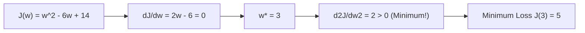

# Notes_22.09: Calculus Optimization Practice Problem [Hinglish]

## 📌 Topic Overview
Is lecture mein Shraddha ma'am ne blackboard par ek complete **Calculus Practice Problem** solve karwaya hai: loss function $J(w) = w^2 - 6w + 14$ ka minimum nikalna aur Gradient Descent se uski convergence verify karna.

---

### 📋 Is Topic Mein Hum Kya Seekhenge?
- Blackboard ka practice question: $J(w) = w^2 - 6w + 14$.
- First derivative $\frac{dJ}{dw} = 0$ karke $w^*$ nikalna.
- Second derivative test se confirm karna ki point minimum hai.
- Gradient descent simulation se wahi answer verify karna.

---

### 🔍 Har Ek Point Ka Simple & Detailed Explanation

#### 1. Blackboard Ka Question:
Humein function diya gaya hai:

$$
J(w) = w^2 - 6w + 14
$$

Humein woh weight $w$ dhoondna hai jahan loss sabse kam (minimum) ho.

#### 2. Step-by-Step Solution:
- **Step 1 (Derivative)**:

$$
\frac{dJ}{dw} = 2w - 6
$$

- **Step 2 (Zero ke barabar rakhein)**:

$$
2w - 6 = 0 \implies 2w = 6 \implies w^* = 3
$$

- **Step 3 (Second derivative test)**:

$$
\frac{d^2J}{dw^2} = 2 > 0
$$

  Kyunki value positive hai, isliye $w=3$ par pakka **Minimum** hai!

- **Step 4 (Minimum loss value)**:

$$
J(3) = 3^2 - 6(3) + 14 = 9 - 18 + 14 = 5
$$

---

### 📊 Visual Flowchart: Solution Workflow



---

### 💻 Python Code

```python
import numpy as np

def solve_optimization_practice_problem():
    """
    Solves Shraddha ma'am's classroom blackboard practice problem:
    Minimize the cost/loss function:
        J(w) = w^2 - 6w + 14
        
    1. Analytical Solution:
       dJ/dw = 2w - 6 = 0 => w* = 3.0
       J(w*) = (3)^2 - 6(3) + 14 = 9 - 18 + 14 = 5.0
       d2J/dw2 = 2 > 0 => Verified Global Minimum!
       
    2. Numerical Gradient Descent Simulation:
       Starts from w_0 = 10.0 and converges to w* = 3.0.
    """
    # Analytical
    w_star = 3.0
    j_min = w_star ** 2 - 6 * w_star + 14
    
    # Numerical Gradient Descent verification
    lr = 0.1
    w = 10.0  # Initial guess far from optimum
    iterations = 25
    trajectory = []
    
    for step in range(iterations):
        loss = w ** 2 - 6 * w + 14
        grad = 2 * w - 6
        trajectory.append({'step': step, 'w': w, 'loss': loss, 'grad': grad})
        w = w - lr * grad
        
    return {
        'analytical_w_opt': w_star,
        'analytical_j_min': j_min,
        'final_gd_w': w,
        'sample_steps': trajectory[::5]
    }

# --- Function Call & Testing ---
solution = solve_optimization_practice_problem()
print(f"Analytical Optimal Weight w* : {solution['analytical_w_opt']:.2f}")
print(f"Minimum Loss Value J(w*)     : {solution['analytical_j_min']:.2f}")
print(f"Final GD Converged Weight    : {solution['final_gd_w']:.4f}")
print()
print(f"{'Step':<6} | {'Current w':<12} | {'Loss J(w)':<12} | {'Gradient':<12}")
print("-" * 48)
for row in solution['sample_steps']:
    print(f"{row['step']:<6} | {row['w']:<12.4f} | {row['loss']:<12.4f} | {row['grad']:<12.4f}")
```

---

### 📌 Summary Points
- Calculus se exact optimum value haath se nikal aati hai.
- Yahi math aage chalkar Linear Regression ke Cost Function mein use hota hai.
