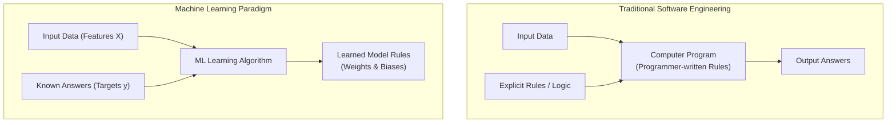

# Lecture 23.01: Introduction to Machine Learning

## 📌 Topic Overview
In this lecture, Shraddha ma'am introduces the foundational paradigm of **Machine Learning**, contrasting traditional rule-based software engineering against data-driven learning.

---

## 🏛️ Traditional Programming vs Machine Learning



---

## 💡 What is Machine Learning?
Arthur Samuel (1959) famously defined Machine Learning as:
> *"The field of study that gives computers the ability to learn without being explicitly programmed."*

Instead of humans writing thousands of `if-else` conditions for every edge case, an algorithm inspects historical dataset patterns and mathematically derives optimal decision rules.

---

## 💻 Python Implementation

```python
def compare_programming_paradigms():
    """
    Demonstrates the fundamental shift from Traditional Programming to Machine Learning:
    - Traditional: Rules + Data => Output Answers
    - Machine Learning: Data + Output Answers => Learned Rules (Model Parameters)
    """
    # 1. Traditional Programming Example: Hardcoded Rule
    def traditional_celsius_to_fahrenheit(celsius):
        return (celsius * 9/5) + 32  # Explicit rule hardcoded by programmer
        
    # 2. Machine Learning Paradigm: Infer rule from (X, y) data pairs
    known_data = [
        {'celsius': 0.0, 'fahrenheit': 32.0},
        {'celsius': 100.0, 'fahrenheit': 212.0},
        {'celsius': -40.0, 'fahrenheit': -40.0}
    ]
    
    # Deriving slope (m) and intercept (c) from data pairs
    c1, f1 = known_data[0]['celsius'], known_data[0]['fahrenheit']
    c2, f2 = known_data[1]['celsius'], known_data[1]['fahrenheit']
    learned_slope = (f2 - f1) / (c2 - c1)
    learned_intercept = f1 - learned_slope * c1
    
    return {
        'traditional_test_100C': traditional_celsius_to_fahrenheit(100.0),
        'learned_rule_slope': learned_slope,
        'learned_rule_intercept': learned_intercept,
        'ml_inferred_formula': f"F = {learned_slope:.1f} * C + {learned_intercept:.1f}"
    }

# --- Function Call & Testing ---
comparison = compare_programming_paradigms()
print("Traditional Rule Output (100 C):", comparison['traditional_test_100C'])
print("ML Learned Slope (Weights)     :", comparison['learned_rule_slope'])
print("ML Learned Intercept (Bias)    :", comparison['learned_rule_intercept'])
print("Inferred Model Rule            :", comparison['ml_inferred_formula'])
```

---

## 🔑 Key Takeaways
1. Traditional programming requires human experts to formulate every single rule.
2. Machine learning inverts the workflow: given data and historical outcomes, the computer learns the governing rules.
3. Machine learning models generalize from training observations to predict accurately on unseen future data.
