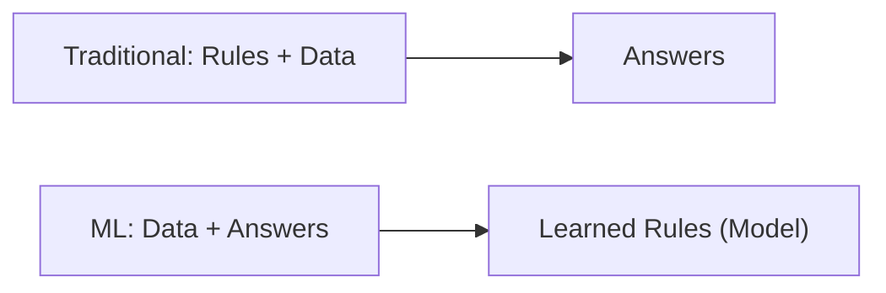

# Notes_23.01: Machine Learning Ka Parichay [Hinglish]

## 📌 Topic Overview
Is lecture mein Shraddha ma'am ne **Machine Learning ke basic concept** ko samjhaya hai: Traditional Software Programming aur Machine Learning mein kya antar hota hai aur AI ki zaroorat kyu padi.

---

### 📋 Is Topic Mein Hum Kya Seekhenge?
- Machine Learning asal mein kya hoti hai?
- Traditional Programming (Rules + Data $\to$ Answers) ka tareeqa.
- Machine Learning (Data + Answers $\to$ Rules) ka naya paradigm shift.
- Real-world example se comparison.

---

### 🔍 Har Ek Point Ka Simple & Detailed Explanation

#### 1. Traditional Programming Kya Hoti Hai?
Pehle ke samay mein coder khud saare rules likhta tha:
Agar kisi bank ko check karna hai ki spam email hai ya nahi, toh programmer hazaron `if-else` likhta tha:
`if "lottery" in email: return Spam`.
Lekin spammers ne spelling badal kar "l0ttery" kar di toh rule toot gaya! Har naye case ke liye insaan rule nahi likh sakta.

#### 2. Machine Learning Ka Naya Tareeqa:
Machine Learning mein hum computer ko **Data** (hazaron emails) aur **Answers** (yeh spam hai, yeh normal hai) dono de dete hain:
Computer data ke andar ke patterns ko khud analyse karke **Rules (Math Function)** generate kar leta hai!

---

### 📊 Visual Flowchart: Dono Ka Antar



---

### 💻 Python Code

```python
def compare_programming_paradigms():
    """
    Demonstrates the fundamental shift from Traditional Programming to Machine Learning:
    - Traditional: Rules + Data => Output Answers
    - Machine Learning: Data + Output Answers => Learned Rules (Model Parameters)
    """
    # 1. Traditional Programming Example: Hardcoded Rule
    def traditional_celsius_to_fahrenheit(celsius):
        return (celsius * 9/5) + 32  # Explicit rule hardcoded by programmer
        
    # 2. Machine Learning Paradigm: Infer rule from (X, y) data pairs
    known_data = [
        {'celsius': 0.0, 'fahrenheit': 32.0},
        {'celsius': 100.0, 'fahrenheit': 212.0},
        {'celsius': -40.0, 'fahrenheit': -40.0}
    ]
    
    # Deriving slope (m) and intercept (c) from data pairs
    c1, f1 = known_data[0]['celsius'], known_data[0]['fahrenheit']
    c2, f2 = known_data[1]['celsius'], known_data[1]['fahrenheit']
    learned_slope = (f2 - f1) / (c2 - c1)
    learned_intercept = f1 - learned_slope * c1
    
    return {
        'traditional_test_100C': traditional_celsius_to_fahrenheit(100.0),
        'learned_rule_slope': learned_slope,
        'learned_rule_intercept': learned_intercept,
        'ml_inferred_formula': f"F = {learned_slope:.1f} * C + {learned_intercept:.1f}"
    }

# --- Function Call & Testing ---
comparison = compare_programming_paradigms()
print("Traditional Rule Output (100 C):", comparison['traditional_test_100C'])
print("ML Learned Slope (Weights)     :", comparison['learned_rule_slope'])
print("ML Learned Intercept (Bias)    :", comparison['learned_rule_intercept'])
print("Inferred Model Rule            :", comparison['ml_inferred_formula'])
```

---

### 📌 Summary Points
- Traditional programming mein rules insaan likhta hai.
- Machine learning mein rules computer khud data dekhkar seekhta hai.
