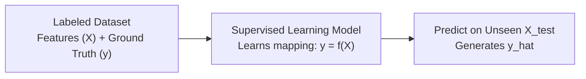

# Lecture 23.02: Types of Machine Learning: Supervised Learning

## 📌 Topic Overview
In this lecture, Shraddha ma'am explores **Supervised Learning**, the dominant branch of machine learning where algorithms learn from **labeled training data**.

---

## 🏛️ Supervised Learning Concept



---

## 💡 The Teacher-Student Analogy
The term **Supervised** originates from the concept of a teacher supervising a student:
- The student is given practice questions (**Features $X$**) along with the answer key (**Labels $y$**).
- The student attempts to solve each problem, compares their answer to the answer key, calculates their error, and corrects their reasoning.
- Once trained, the student is tested on unseen exam questions where no answer key is provided!

---

## 💻 Python Implementation

```python
def demonstrate_supervised_dataset():
    """
    Demonstrates the anatomy of a Supervised Learning dataset:
    - Features (Input Matrix X): Measurable attributes
    - Target (Ground Truth Label y): Desired output variable provided during training
    """
    # Sample tabular dataset for house price prediction
    dataset = [
        {'Size_sqft': 850,  'Bedrooms': 2, 'Age_years': 5,  'Price_lakhs': 45.0},
        {'Size_sqft': 1200, 'Bedrooms': 3, 'Age_years': 2,  'Price_lakhs': 70.0},
        {'Size_sqft': 1600, 'Bedrooms': 3, 'Age_years': 10, 'Price_lakhs': 82.0},
        {'Size_sqft': 2100, 'Bedrooms': 4, 'Age_years': 1,  'Price_lakhs': 120.0}
    ]
    
    # Separate Features X and Target y
    features_X = [{k: v for k, v in row.items() if k != 'Price_lakhs'} for row in dataset]
    targets_y  = [row['Price_lakhs'] for row in dataset]
    
    return features_X, targets_y

# --- Function Call & Testing ---
X_sample, y_sample = demonstrate_supervised_dataset()
print("Supervised Learning Features (X):")
for row in X_sample:
    print(" ", row)
print()
print("Supervised Learning Target Labels (y):")
print(" ", y_sample)
```

---

## 🔑 Key Takeaways
1. Supervised learning requires pairs of inputs $\mathbf{x}^{(i)}$ and corresponding labels $y^{(i)}$.
2. Without ground-truth labels, a task cannot be solved via supervised learning.
3. Primary branches of supervised learning are **Regression** (continuous target) and **Classification** (categorical target).
