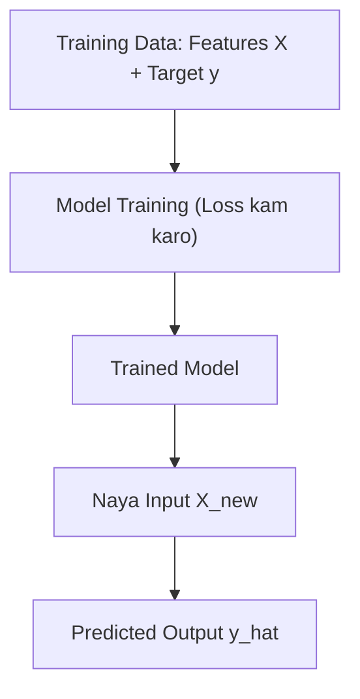

# Notes_23.02: Supervised Learning Ka Parichay [Hinglish]

## 📌 Topic Overview
Is lecture mein Shraddha ma'am ne **Supervised Machine Learning** ka concept samjhaya hai: Labeled Data kya hota hai, Teacher-Student analogy kya hai, aur supervised learning kaise kaam karti hai.

---

### 📋 Is Topic Mein Hum Kya Seekhenge?
- Supervised Learning ki simple definition.
- Labeled Data ka structure (Features $X$ aur Target $y$).
- Teacher aur Student ka live example.
- Supervised learning ke do mukhya prakaar (Regression aur Classification).

---

### 🔍 Har Ek Point Ka Simple & Detailed Explanation

#### 1. Labeled Data Kya Hota Hai?
Maan lijiye aap ek bachhe ko phalon ki pehchan sikha rahe hain:
Aap usse seb (apple) ki photo dikhate hain aur sath mein bolte hain: *"Yeh Apple hai"*.
Yahan photo **Feature ($X$)** hai aur naam "Apple" **Label ($y$)** hai!
Jab dataset ke har record ke sath uska sahi answer (target) diya hota hai, toh usse **Supervised Learning** kehte hain.

#### 2. Teacher-Student Analogy:
Jaise ek teacher student ko pehle sawal aur jawab dono sikhata hai, fir exam mein sirf naye sawal deta hai aur student answer nikalta hai — bilkul wahi kaam machine learning model karta hai.

---

### 📊 Visual Flowchart: Supervised Flow



---

### 💻 Python Code

```python
def demonstrate_supervised_dataset():
    """
    Demonstrates the anatomy of a Supervised Learning dataset:
    - Features (Input Matrix X): Measurable attributes
    - Target (Ground Truth Label y): Desired output variable provided during training
    """
    # Sample tabular dataset for house price prediction
    dataset = [
        {'Size_sqft': 850,  'Bedrooms': 2, 'Age_years': 5,  'Price_lakhs': 45.0},
        {'Size_sqft': 1200, 'Bedrooms': 3, 'Age_years': 2,  'Price_lakhs': 70.0},
        {'Size_sqft': 1600, 'Bedrooms': 3, 'Age_years': 10, 'Price_lakhs': 82.0},
        {'Size_sqft': 2100, 'Bedrooms': 4, 'Age_years': 1,  'Price_lakhs': 120.0}
    ]
    
    # Separate Features X and Target y
    features_X = [{k: v for k, v in row.items() if k != 'Price_lakhs'} for row in dataset]
    targets_y  = [row['Price_lakhs'] for row in dataset]
    
    return features_X, targets_y

# --- Function Call & Testing ---
X_sample, y_sample = demonstrate_supervised_dataset()
print("Supervised Learning Features (X):")
for row in X_sample:
    print(" ", row)
print()
print("Supervised Learning Target Labels (y):")
print(" ", y_sample)
```

---

### 📌 Summary Points
- Supervised learning ke liye labeled data zaroori hai.
- Model input $X$ aur output $y$ ke beech ka mathematical relationship seekhta hai.
