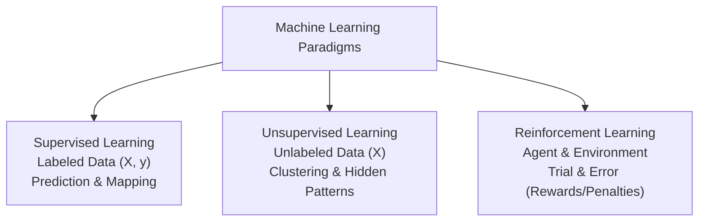

# Lecture 23.03: Types of Machine Learning: Unsupervised & Reinforcement Learning

## 📌 Topic Overview
In this lecture, Shraddha ma'am covers **Unsupervised Learning** and **Reinforcement Learning (RL)**, contrasting their data requirements and optimization objectives with Supervised Learning.

---

## 🏛️ The Three Pillars of Machine Learning



---

## 🔍 Unsupervised Learning vs Reinforcement Learning

### 1. Unsupervised Learning (No Labels)
- Only input features $X$ are provided (no ground truth $y$).
- The algorithm groups similar samples together based on intrinsic data geometry and feature similarities.
- **Example**: Customer segmentation for targeted marketing (K-Means).

### 2. Reinforcement Learning (Agent & Environment)
- Learns through interactive trial-and-error feedback.
- An **Agent** takes an **Action** in an **Environment**, moves to a new **State**, and receives a scalar **Reward** or **Penalty**.
- **Example**: AlphaGo, self-driving cars, humanoid robotic walking.

---

## 💻 Python Implementation

```python
def summarize_ml_taxonomy():
    """
    Returns a comprehensive structural taxonomy of Machine Learning paradigms:
    1. Supervised Learning
    2. Unsupervised Learning
    3. Reinforcement Learning
    """
    taxonomy = {
        'Supervised Learning': {
            'Data Nature': 'Labeled pairs (X, y)',
            'Core Objective': 'Predict target outcome for unseen inputs',
            'Primary Tasks': ['Regression', 'Classification'],
            'Popular Algorithms': ['Linear Regression', 'Logistic Regression', 'KNN', 'Decision Trees']
        },
        'Unsupervised Learning': {
            'Data Nature': 'Unlabeled features only (X)',
            'Core Objective': 'Discover hidden structures, groupings, or representations',
            'Primary Tasks': ['Clustering', 'Dimensionality Reduction', 'Anomaly Detection'],
            'Popular Algorithms': ['K-Means', 'Hierarchical Clustering', 'PCA', 't-SNE']
        },
        'Reinforcement Learning': {
            'Data Nature': 'Interactive environment states, actions, rewards',
            'Core Objective': 'Learn optimal policy to maximize cumulative reward',
            'Primary Tasks': ['Game Playing', 'Robotics', 'Autonomous Driving'],
            'Popular Algorithms': ['Q-Learning', 'Deep Q-Networks (DQN)', 'PPO']
        }
    }
    return taxonomy

# --- Function Call & Testing ---
tax = summarize_ml_taxonomy()
for paradigm, details in tax.items():
    print(f"=== {paradigm} ===")
    print(f"  Data Type : {details['Data Nature']}")
    print(f"  Goal      : {details['Core Objective']}")
    print(f"  Tasks     : {', '.join(details['Primary Tasks'])}")
    print(f"  Algorithms: {', '.join(details['Popular Algorithms'])}")
    print()
```

---

## 🔑 Key Takeaways
1. Supervised learning requires human annotation; unsupervised learning groups raw data autonomously.
2. Reinforcement learning optimizes sequential decision-making over time via cumulative reward signals.
