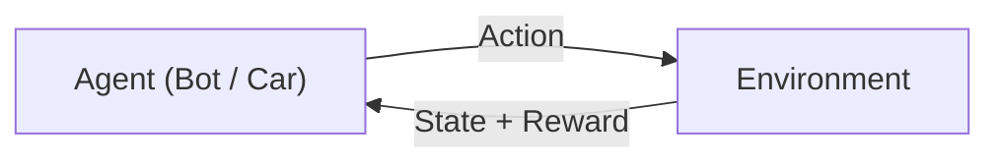

# Notes_23.03: Unsupervised Aur Reinforcement Learning [Hinglish]

## 📌 Topic Overview
Is lecture mein Shraddha ma'am ne **Unsupervised Learning** aur **Reinforcement Learning** ke bare mein bataya hai: bina labels ke data kaise group hota hai aur trial-and-error se robots kaise seekhte hain.

---

### 📋 Is Topic Mein Hum Kya Seekhenge?
- Unsupervised Learning kya hai (Bina answers wala data).
- Clustering aur Customer Segmentation ka use case.
- Reinforcement Learning: Agent, Environment, Reward aur Penalty.
- Teeno paradigms ka comparison table.

---

### 🔍 Har Ek Point Ka Simple & Detailed Explanation

#### 1. Unsupervised Learning (Bina Label Ka Data):
Yahan koi answer key ($y$) nahi hoti.
Maan lijiye ek dukaan mein hazaron customers aate hain. Algorithm unki shopping habits dekhkar unhe alag-alag groups (Clusters) mein baant deta hai:
- Group 1: Budget khareedari karne wale.
- Group 2: Mehenge brands lene wale.
Isse hum **K-Means Clustering** bolte hain.

#### 2. Reinforcement Learning (Trial & Error Se Seekhna):
Jaise ek chhota bachha chalna seekhta hai:
- Bachha kadam aage badhata hai $\implies$ girta hai (Dard/Penalty).
- Bachha sambhal kar chalta hai $\implies$ chocolate milti hai (Reward).
Bachha baar-baar koshish karke reward maximize karna seekh jata hai. Isi tareeqe se self-driving cars aur chess-playing bots seekhte hain.

---

### 📊 Visual Flowchart: RL Loop



---

### 💻 Python Code

```python
def summarize_ml_taxonomy():
    """
    Returns a comprehensive structural taxonomy of Machine Learning paradigms:
    1. Supervised Learning
    2. Unsupervised Learning
    3. Reinforcement Learning
    """
    taxonomy = {
        'Supervised Learning': {
            'Data Nature': 'Labeled pairs (X, y)',
            'Core Objective': 'Predict target outcome for unseen inputs',
            'Primary Tasks': ['Regression', 'Classification'],
            'Popular Algorithms': ['Linear Regression', 'Logistic Regression', 'KNN', 'Decision Trees']
        },
        'Unsupervised Learning': {
            'Data Nature': 'Unlabeled features only (X)',
            'Core Objective': 'Discover hidden structures, groupings, or representations',
            'Primary Tasks': ['Clustering', 'Dimensionality Reduction', 'Anomaly Detection'],
            'Popular Algorithms': ['K-Means', 'Hierarchical Clustering', 'PCA', 't-SNE']
        },
        'Reinforcement Learning': {
            'Data Nature': 'Interactive environment states, actions, rewards',
            'Core Objective': 'Learn optimal policy to maximize cumulative reward',
            'Primary Tasks': ['Game Playing', 'Robotics', 'Autonomous Driving'],
            'Popular Algorithms': ['Q-Learning', 'Deep Q-Networks (DQN)', 'PPO']
        }
    }
    return taxonomy

# --- Function Call & Testing ---
tax = summarize_ml_taxonomy()
for paradigm, details in tax.items():
    print(f"=== {paradigm} ===")
    print(f"  Data Type : {details['Data Nature']}")
    print(f"  Goal      : {details['Core Objective']}")
    print(f"  Tasks     : {', '.join(details['Primary Tasks'])}")
    print(f"  Algorithms: {', '.join(details['Popular Algorithms'])}")
    print()
```

---

### 📌 Summary Points
- Unsupervised learning mein labels nahi hote, patterns khojte hain.
- Reinforcement learning mein agent rewards maximize karta hai.
