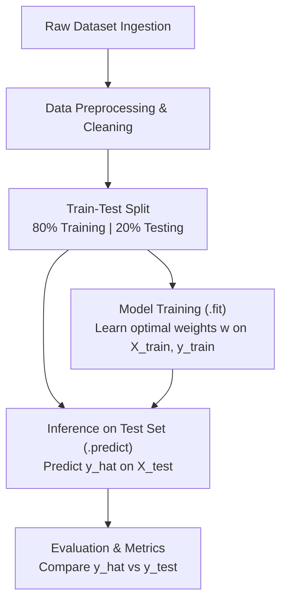

# Lecture 23.04: Supervised Machine Learning Workflow & Components

## 📌 Topic Overview
In this lecture, Shraddha ma'am breaks down the end-to-end **Lifecycle of a Supervised Machine Learning Project**, from data ingestion to model evaluation and generalization.

---

## 🏛️ End-to-End Supervised ML Pipeline



---

## 🛠️ The Core Components
1. **Feature Matrix ($X$)**: A 2D array of shape $(m, d)$ where $m$ is the number of samples and $d$ is the number of input features.
2. **Target Vector ($y$)**: A 1D array of shape $(m,)$ containing ground-truth values.
3. **Train-Test Split**: We MUST evaluate the model on data it has never seen during training to verify true generalization and catch overfitting.

---

## 💻 Python Implementation

```python
from sklearn.model_selection import train_test_split
import numpy as np

def demonstrate_supervised_workflow():
    """
    Simulates the standard 6-stage Supervised Machine Learning pipeline:
    1. Problem Definition & Data Ingestion
    2. Feature Matrix (X) and Target Vector (y) formulation
    3. Train-Test Split (Preventing Data Leakage & Overfitting)
    4. Model Instantiation & Training (.fit)
    5. Inference on Test Split (.predict)
    6. Performance Evaluation against Ground Truth
    """
    # 1. Synthetic dataset: 100 samples, 2 features
    np.random.seed(42)
    X = np.random.uniform(10, 50, size=(100, 2))
    # True relationship: y = 2.5*x1 + 1.2*x2 + noise
    y = 2.5 * X[:, 0] + 1.2 * X[:, 1] + np.random.normal(0, 2, size=100)
    
    # 2. Train-Test Split (80% train, 20% test)
    X_train, X_test, y_train, y_test = train_test_split(
        X, y, test_size=0.20, random_state=42
    )
    
    pipeline_summary = {
        'total_samples': len(X),
        'train_samples': len(X_train),
        'test_samples': len(X_test),
        'features_shape': X_train.shape,
        'target_shape': y_train.shape
    }
    return pipeline_summary

# --- Function Call & Testing ---
summary = demonstrate_supervised_workflow()
print("Supervised Pipeline Split Summary:")
for k, v in summary.items():
    print(f"  {k}: {v}")
```

---

## 🔑 Key Takeaways
1. Never evaluate a model solely on its training data.
2. Train-test split is mandatory for objective validation.
3. Supervised learning pipelines follow a strict, standardized execution sequence.
