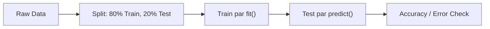

# Notes_23.04: Supervised Learning Ka Workflow Aur Components [Hinglish]

## 📌 Topic Overview
Is lecture mein Shraddha ma'am ne **Supervised Machine Learning ke complete lifecycle** ko samjhaya hai: data lene se lekar model train karne aur test karne tak ka standard step-by-step procedure.

---

### 📋 Is Topic Mein Hum Kya Seekhenge?
- Supervised ML project ke 6 main steps.
- Feature Matrix ($X$) aur Target Vector ($y$) kya hote hain.
- Train-Test Split (80/20) kyu zaroori hota hai?
- Model ko naye data par test karne ka golden rule.

---

### 🔍 Har Ek Point Ka Simple & Detailed Explanation

#### 1. Supervised Learning Ka Standard Pipeline:
1. **Data Ingestion**: Dataset ko load karna.
2. **Data Cleaning**: Missing values aur outliers ko theek karna.
3. **Train-Test Split**: Data ke do tukde karna:
   - **80% Training Data**: Isse model padhai karta hai (`fit`).
   - **20% Testing Data**: Isse exam liya jata hai (`predict`).
4. **Model Training**: Weights optimize karna.
5. **Evaluation**: Check karna ki test exam mein model ke kitne marks aaye.

#### 2. Test Set Par Check Karna Kyu Zaroori Hai?
Agar aap student ko wahi questions exam mein de do jo usne class mein rate the, toh woh bina samjhe 100/100 le aayega (Ratta marna / Overfitting). Asal test tabhi hota hai jab question paper mein naye sawal hon!

---

### 📊 Visual Flowchart: Project Pipeline



---

### 💻 Python Code

```python
from sklearn.model_selection import train_test_split
import numpy as np

def demonstrate_supervised_workflow():
    """
    Simulates the standard 6-stage Supervised Machine Learning pipeline:
    1. Problem Definition & Data Ingestion
    2. Feature Matrix (X) and Target Vector (y) formulation
    3. Train-Test Split (Preventing Data Leakage & Overfitting)
    4. Model Instantiation & Training (.fit)
    5. Inference on Test Split (.predict)
    6. Performance Evaluation against Ground Truth
    """
    # 1. Synthetic dataset: 100 samples, 2 features
    np.random.seed(42)
    X = np.random.uniform(10, 50, size=(100, 2))
    # True relationship: y = 2.5*x1 + 1.2*x2 + noise
    y = 2.5 * X[:, 0] + 1.2 * X[:, 1] + np.random.normal(0, 2, size=100)
    
    # 2. Train-Test Split (80% train, 20% test)
    X_train, X_test, y_train, y_test = train_test_split(
        X, y, test_size=0.20, random_state=42
    )
    
    pipeline_summary = {
        'total_samples': len(X),
        'train_samples': len(X_train),
        'test_samples': len(X_test),
        'features_shape': X_train.shape,
        'target_shape': y_train.shape
    }
    return pipeline_summary

# --- Function Call & Testing ---
summary = demonstrate_supervised_workflow()
print("Supervised Pipeline Split Summary:")
for k, v in summary.items():
    print(f"  {k}: {v}")
```

---

### 📌 Summary Points
- Hamesha data ko train aur test mein baatein.
- Model ki asli kaabiliyat test set par hi pata chalti hai.
