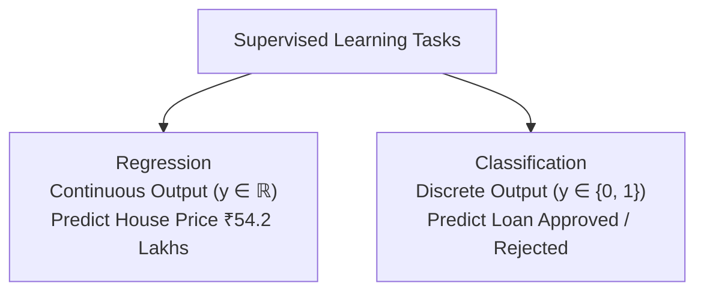

# Lecture 23.05: Regression vs. Classification Tasks

## 📌 Topic Overview
In this lecture, Shraddha ma'am contrasts the two core problem types of supervised learning: **Regression** (predicting continuous numerical quantities) and **Classification** (predicting discrete categorical labels).

---

## 🏛️ Comparison: Regression vs Classification

| Dimension | Regression Task | Classification Task |
| :--- | :--- | :--- |
| **Target Variable ($y$)** | Continuous real number ($y \in \mathbb{R}$) | Discrete categorical class ($y \in \{C_1, C_2, \dots\}$) |
| **Core Question** | *"How much?"* or *"What value?"* | *"Which category?"* or *"Is it A or B?"* |
| **Output Space** | Infinite possible values | Finite distinct classes |
| **Example Domains** | House prices, stock returns, temperature | Spam detection, disease diagnosis, credit approval |
| **Evaluation Metrics** | MAE, MSE, RMSE, $R^2$ | Accuracy, Precision, Recall, F1, ROC-AUC |



---

## 💻 Python Implementation

```python
def classify_task_type(target_values):
    """
    Determines whether a machine learning task is Regression or Classification
    based on the data characteristics of the target variable.
    """
    import numpy as np
    target_arr = np.array(target_values)
    
    # Check if target is continuous float or has many unique values
    unique_count = len(np.unique(target_arr))
    is_float = np.issubdtype(target_arr.dtype, np.floating)
    
    if is_float and unique_count > 10:
        task_type = "Regression"
        desc = "Target is continuous real-valued quantity (e.g., Price, Salary, Temperature)."
        metrics = ["Mean Absolute Error (MAE)", "Mean Squared Error (MSE)", "R-squared"]
    else:
        task_type = "Classification"
        desc = "Target consists of discrete categorical classes (e.g., 0/1, Spam/Ham, High/Med/Low)."
        metrics = ["Accuracy", "Precision", "Recall", "F1-Score"]
        
    return {
        'detected_task': task_type,
        'unique_values': unique_count,
        'description': desc,
        'recommended_metrics': metrics
    }

# --- Function Call & Testing ---
house_prices = [45.5, 72.1, 89.0, 110.5, 55.2, 63.8, 95.0, 120.4, 48.0, 81.2, 105.0]
spam_labels  = [0, 1, 0, 0, 1, 1, 0, 1, 0, 1]

print("House Prices Task :", classify_task_type(house_prices)['detected_task'])
print("Spam Detection Task:", classify_task_type(spam_labels)['detected_task'])
```

---

## 🔑 Key Takeaways
1. If the target is a continuous number with infinite possible values, it is Regression.
2. If the target falls into discrete buckets or classes, it is Classification.
3. Choosing the right algorithm and evaluation metric begins with identifying this distinction.
