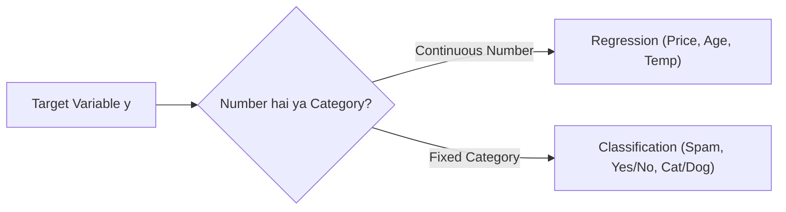

# Notes_23.05: Regression vs Classification Tasks [Hinglish]

## 📌 Topic Overview
Is lecture mein Shraddha ma'am ne Supervised Learning ke do sabse mukhya hisso (**Regression** aur **Classification**) ke beech ka farq bohot simple tareeqe se samjhaya hai.

---

### 📋 Is Topic Mein Hum Kya Seekhenge?
- Regression kya hota hai (Continuous numbers predict karna).
- Classification kya hota hai (Categories ya Groups predict karna).
- Real-world examples (Ghar ki keemat vs Email spam).
- Dono ke alag-alag evaluation metrics.

---

### 🔍 Har Ek Point Ka Simple & Detailed Explanation

#### 1. Regression (Continuous Number):
Jab aapko koi aisi cheez predict karni ho jo koi bhi number ho sakti hai:
- *"Is ghar ki keemat kitni hogi?"* $\implies$ ₹45.5 Lakh ya ₹45.62 Lakh.
- *"Kal temperature kitna hoga?"* $\implies$ 32.4°C.
Yahan infinite possible values hoti hain. Isko **Regression** kehte hain.

#### 2. Classification (Discrete Category):
Jab aapko koi category ya label chunna ho:
- *"Yeh email Spam hai ya Not Spam?"* (Sirf 2 options: 0 ya 1).
- *"Patient ko bimari hai ya nahi?"* (Yes / No).
Yahan fixed buckets hote hain. Isko **Classification** kehte hain.

---

### 📊 Visual Flowchart: Decision



---

### 💻 Python Code

```python
def classify_task_type(target_values):
    """
    Determines whether a machine learning task is Regression or Classification
    based on the data characteristics of the target variable.
    """
    import numpy as np
    target_arr = np.array(target_values)
    
    # Check if target is continuous float or has many unique values
    unique_count = len(np.unique(target_arr))
    is_float = np.issubdtype(target_arr.dtype, np.floating)
    
    if is_float and unique_count > 10:
        task_type = "Regression"
        desc = "Target is continuous real-valued quantity (e.g., Price, Salary, Temperature)."
        metrics = ["Mean Absolute Error (MAE)", "Mean Squared Error (MSE)", "R-squared"]
    else:
        task_type = "Classification"
        desc = "Target consists of discrete categorical classes (e.g., 0/1, Spam/Ham, High/Med/Low)."
        metrics = ["Accuracy", "Precision", "Recall", "F1-Score"]
        
    return {
        'detected_task': task_type,
        'unique_values': unique_count,
        'description': desc,
        'recommended_metrics': metrics
    }

# --- Function Call & Testing ---
house_prices = [45.5, 72.1, 89.0, 110.5, 55.2, 63.8, 95.0, 120.4, 48.0, 81.2, 105.0]
spam_labels  = [0, 1, 0, 0, 1, 1, 0, 1, 0, 1]

print("House Prices Task :", classify_task_type(house_prices)['detected_task'])
print("Spam Detection Task:", classify_task_type(spam_labels)['detected_task'])
```

---

### 📌 Summary Points
- Number predict karna = Regression.
- Class/Group predict karna = Classification.
