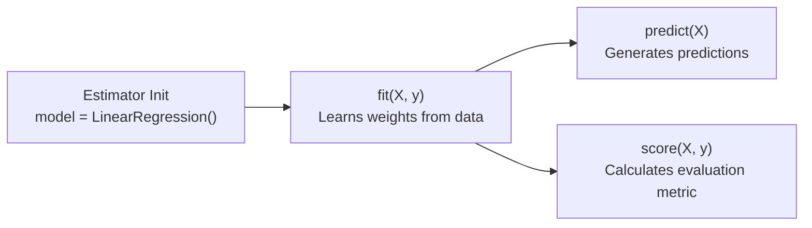

# Lecture 23.06: Introduction to Scikit-Learn (sklearn API Design)

## 📌 Topic Overview
In this lecture, Shraddha ma'am introduces **Scikit-Learn (`sklearn`)**, Python's premier machine learning library, focusing on its unified, consistent object-oriented API design.

---

## 🏛️ The Three Pillars of Scikit-Learn API



---

## 💡 The Consistency Principle
Every single algorithm in Scikit-Learn follows the exact same interface:
1. **`fit(X, y)`**: Fits the model to training data.
2. **`predict(X)`**: Generates target predictions.
3. **`transform(X)`**: For scalers and encoders, transforms features into new representations.
4. **`fit_transform(X)`**: Efficiently combines both steps.

Whether you are using Linear Regression, Random Forest, SVM, or Naive Bayes, the API remains 100% identical!

---

## 💻 Python Implementation

```python
def demonstrate_sklearn_api_principles():
    """
    Demonstrates Scikit-Learn's world-standard API design principles:
    1. Estimator: Initializes hyperparameters (e.g., LinearRegression())
    2. fit(X, y): Learns model parameters from training data
    3. predict(X): Generates predictions on new data
    4. transform(X): Preprocesses features without altering shape (Transformers)
    """
    from sklearn.linear_model import LinearRegression
    import numpy as np
    
    # 1. Toy training data: y = 2*x + 1
    X_train = np.array([[1.0], [2.0], [3.0], [4.0]])
    y_train = np.array([3.0, 5.0, 7.0, 9.0])
    
    # 2. Estimator Initialization
    model = LinearRegression()
    
    # 3. Fit: Learns coefficients
    model.fit(X_train, y_train)
    
    # 4. Predict
    X_new = np.array([[5.0], [6.0]])
    predictions = model.predict(X_new)
    
    return {
        'learned_slope_coef': float(model.coef_[0]),
        'learned_intercept': float(model.intercept_),
        'new_inputs': X_new.flatten().tolist(),
        'predictions': predictions.tolist()
    }

# --- Function Call & Testing ---
sklearn_demo = demonstrate_sklearn_api_principles()
print("Scikit-Learn API Workflow:")
print(f"  Learned Slope (w1)     : {sklearn_demo['learned_slope_coef']:.2f}")
print(f"  Learned Intercept (w0) : {sklearn_demo['learned_intercept']:.2f}")
print(f"  Inputs {sklearn_demo['new_inputs']} => Predictions: {sklearn_demo['predictions']}")
```

---

## 🔑 Key Takeaways
1. Scikit-Learn provides a unified API across hundreds of algorithms.
2. `fit()` learns internal parameters (saved with trailing underscores, e.g., `model.coef_`, `model.intercept_`).
3. `predict()` applies learned parameters to new data.
