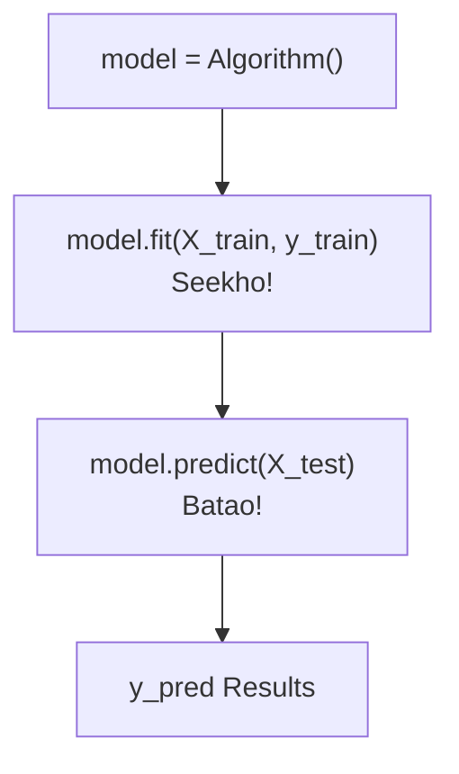

# Notes_23.06: Scikit-Learn (sklearn) Ka Parichay [Hinglish]

## 📌 Topic Overview
Is lecture mein Shraddha ma'am ne Python ki sabse famous Machine Learning library **Scikit-Learn (`sklearn`)** ka structure aur uske standard methods (`fit`, `predict`) ko samjhaya hai.

---

### 📋 Is Topic Mein Hum Kya Seekhenge?
- Scikit-Learn kya hai aur ML mein iska itna dabdaba kyu hai?
- Scikit-Learn ke 3 golden methods: `fit()`, `predict()`, aur `score()`.
- Konsistent API design ka faayda.
- Trailing underscore attributes (jaise `model.coef_`, `model.intercept_`).

---

### 🔍 Har Ek Point Ka Simple & Detailed Explanation

#### 1. Consistent API Design:
Duniya ka chahe koi bhi algorithm ho (Linear Regression, Decision Tree, ya SVM), sklearn mein code bilkul ek jaisa likha jata hai:
1. Model banao: `model = LinearRegression()`
2. Model ko padhao: `model.fit(X_train, y_train)`
3. Naye data par test karo: `y_pred = model.predict(X_test)`

#### 2. Trailing Underscores (`_`) Ka Matlab:
Jab aap model train karte hain, toh jo parameters model ne seekhe hote hain unke aage underscore laga hota hai:
- `model.coef_`: Seekha hua slope ($m$).
- `model.intercept_`: Seekha hua intercept ($c$).

---

### 📊 Visual Flowchart: sklearn API



---

### 💻 Python Code

```python
def demonstrate_sklearn_api_principles():
    """
    Demonstrates Scikit-Learn's world-standard API design principles:
    1. Estimator: Initializes hyperparameters (e.g., LinearRegression())
    2. fit(X, y): Learns model parameters from training data
    3. predict(X): Generates predictions on new data
    4. transform(X): Preprocesses features without altering shape (Transformers)
    """
    from sklearn.linear_model import LinearRegression
    import numpy as np
    
    # 1. Toy training data: y = 2*x + 1
    X_train = np.array([[1.0], [2.0], [3.0], [4.0]])
    y_train = np.array([3.0, 5.0, 7.0, 9.0])
    
    # 2. Estimator Initialization
    model = LinearRegression()
    
    # 3. Fit: Learns coefficients
    model.fit(X_train, y_train)
    
    # 4. Predict
    X_new = np.array([[5.0], [6.0]])
    predictions = model.predict(X_new)
    
    return {
        'learned_slope_coef': float(model.coef_[0]),
        'learned_intercept': float(model.intercept_),
        'new_inputs': X_new.flatten().tolist(),
        'predictions': predictions.tolist()
    }

# --- Function Call & Testing ---
sklearn_demo = demonstrate_sklearn_api_principles()
print("Scikit-Learn API Workflow:")
print(f"  Learned Slope (w1)     : {sklearn_demo['learned_slope_coef']:.2f}")
print(f"  Learned Intercept (w0) : {sklearn_demo['learned_intercept']:.2f}")
print(f"  Inputs {sklearn_demo['new_inputs']} => Predictions: {sklearn_demo['predictions']}")
```

---

### 📌 Summary Points
- sklearn Python ki official industry standard ML library hai.
- `fit()` model ko train karta hai, `predict()` predictions nikalta hai.
