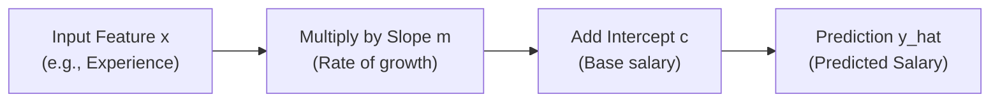

# Lecture 23.07: Starting with Linear Regression

## 📌 Topic Overview
In this lecture, Shraddha ma'am introduces the foundational supervised learning algorithm: **Simple Linear Regression**, examining the linear relationship hypothesis $\hat{y} = mx + c$ between a single predictor feature and a continuous target.

---

## 🏛️ The Linear Regression Equation

$$
\hat{y} = mx + c \quad \text{or} \quad \hat{y} = w_1 x + w_0
$$

Where:
- $\hat{y}$: Predicted target output.
- $x$: Input feature value.
- $m$ (or $w_1$): **Slope / Weight** — represents the rate of change in $y$ for each one-unit increase in $x$.
- $c$ (or $w_0$): **Intercept / Bias** — the baseline value of $y$ when $x = 0$.



---

## 💻 Python Implementation

```python
import numpy as np

def compute_linear_regression_line(x_vals, m, c):
    """
    Computes Linear Regression line predictions:
        y_hat = m * x + c
        
    Args:
        x_vals: 1D array of input feature values
        m: Slope (Weight / Coefficient w1)
        c: Intercept (Bias w0)
        
    Returns:
        1D array of predicted y_hat values
    """
    y_hat = m * np.array(x_vals) + c
    return y_hat

# --- Function Call & Testing ---
# Experience in years (x) vs Salary in lakhs (y)
experience = np.array([1, 2, 3, 4, 5])
# Suppose m = 2.5 (2.5 Lakhs per year of exp) and c = 3.0 (Base salary 3 Lakhs)
predicted_salary = compute_linear_regression_line(experience, m=2.5, c=3.0)

print(f"{'Experience (Years)':<20} | {'Predicted Salary (Lakhs)':<25}")
print("-" * 50)
for exp, sal in zip(experience, predicted_salary):
    print(f"{exp:<20} | {sal:<25.2f}")
```

---

## 🔑 Key Takeaways
1. Linear Regression models a straight-line relationship between inputs and continuous targets.
2. The slope $m$ governs line steepness; the intercept $c$ governs vertical positioning.
3. Machine learning's job is to discover the best $m$ and $c$ that minimize total prediction errors.
