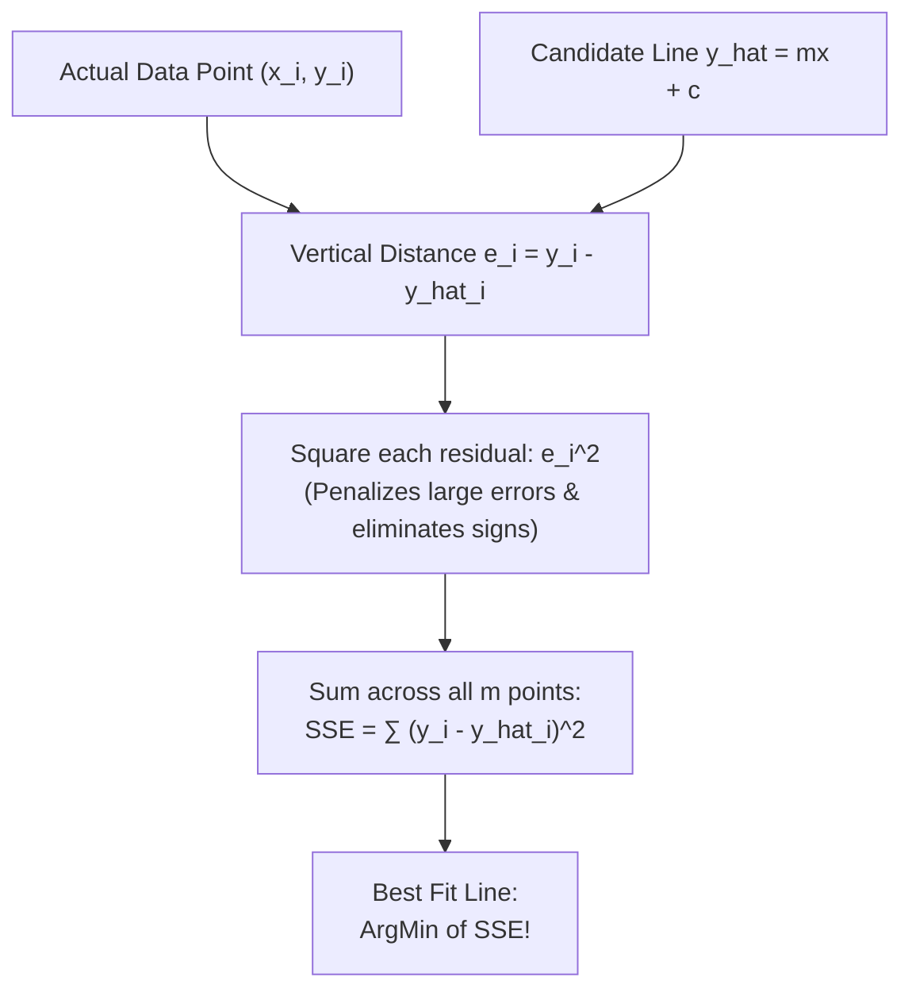

# Lecture 23.08: What is the Best Fit Line? (Residuals & OLS)

## 📌 Topic Overview
In this lecture, Shraddha ma'am explains what makes a line the **"Best Fit Line"**, formalizing prediction errors as **Residuals** and introducing the criterion of **Ordinary Least Squares (OLS)**.

---

## 🏛️ Residuals & Ordinary Least Squares

For each sample $(x_i, y_i)$, the vertical distance between the actual data point and the candidate line $\hat{y}_i$ is called the **Residual**:

$$
e_i = y_i - \hat{y}_i = y_i - (mx_i + c)
$$



---

## 💡 Why Square the Residuals?
1. **Prevents Cancellation**: Positive errors (points above line) and negative errors (points below line) do not cancel each other out to zero.
2. **Penalizes Outliers**: Squaring heavily penalizes large errors ($5^2 = 25$, while $10^2 = 100$), encouraging the line to fit reasonably close to all points.
3. **Smooth Differentiability**: Unlike absolute values $|e_i|$, squared terms $e_i^2$ have clean, continuous derivatives everywhere.

---

## 💻 Python Implementation

```python
import numpy as np

def compute_residuals_and_sse(x_pts, y_pts, m, c):
    """
    Computes point-by-point residuals (errors) and the Sum of Squared Errors (SSE)
    for a candidate linear regression line: y_hat = m*x + c.
    
    Residual e_i = y_i - y_hat_i
    SSE = sum(e_i^2)
    """
    x = np.array(x_pts)
    y = np.array(y_pts)
    
    y_pred = m * x + c
    residuals = y - y_pred
    squared_errors = residuals ** 2
    sse = np.sum(squared_errors)
    
    return {
        'x': x.tolist(),
        'y_actual': y.tolist(),
        'y_pred': y_pred.round(2).tolist(),
        'residuals': residuals.round(2).tolist(),
        'sse': float(sse)
    }

# --- Function Call & Testing ---
# Sample data points: (1, 2), (2, 3), (3, 5), (4, 4), (5, 6)
x_data = [1, 2, 3, 4, 5]
y_data = [2, 3, 5, 4, 6]

# Candidate 1: m=1.0, c=0.5
cand1 = compute_residuals_and_sse(x_data, y_data, m=1.0, c=0.5)
# Candidate 2: m=0.9, c=1.3
cand2 = compute_residuals_and_sse(x_data, y_data, m=0.9, c=1.3)

print("Candidate 1 (m=1.0, c=0.5) SSE:", cand1['sse'])
print("Candidate 2 (m=0.9, c=1.3) SSE:", cand2['sse'])
winner = "Candidate 1" if cand1['sse'] < cand2['sse'] else "Candidate 2"
print(f"Better Fit (Lower SSE): {winner}")
```

---

## 🔑 Key Takeaways
1. A line is defined as the "Best Fit Line" when it minimizes the sum of squared residuals across all training points.
2. Ordinary Least Squares is the gold standard criterion for linear regression fitting.
