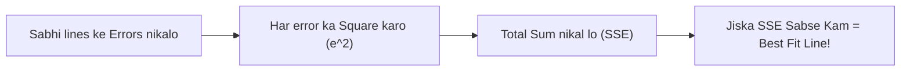

# Notes_23.08: Best Fit Line Kya Hoti Hai? [Hinglish]

## 📌 Topic Overview
Is lecture mein Shraddha ma'am ne **Best Fit Line** ka concept samjhaya hai: infinite lines mein se kaunsi line sabse best hoti hai, **Residual (Error)** kya hota hai, aur **Ordinary Least Squares (OLS)** kaise kaam karta hai.

---

### 📋 Is Topic Mein Hum Kya Seekhenge?
- Best Fit Line ki aasan definition.
- Residual ($e_i = y_i - \hat{y}_i$) ka matlab (Vertical doori).
- Errors ka square kyu karte hain? (Negative cancel na ho).
- OLS (Ordinary Least Squares) method.

---

### 🔍 Har Ek Point Ka Simple & Detailed Explanation

#### 1. Residual (Error) Kya Hota Hai?
Blackboard par ma'am ne graph banakar dikhaya:
Graph par ek actual data point hai $(x_i, y_i)$ aur uske theek upar ya neeche hamari line guzar rahi hai $\hat{y}_i$.
Dono ke beech ki vertical doori ko **Residual ($e_i$)** kehte hain:

$$
e_i = y_i - \hat{y}_i
$$

#### 2. Square Kyu Karte Hain?
Agar ek point par error $+5$ hai aur doosre point par $-5$:
Agar seedha sum karoge toh $+5 + (-5) = 0$ ho jayega! Model bolega "Error 0 hai, sab perfect hai", jabki dono predictions galat the!
Isliye hum har error ka square karte hain ($5^2 + (-5)^2 = 25 + 25 = 50$).
**Jis line ka total squared error sabse kam hota hai, wahi Best Fit Line kehlati hai!**

---

### 📊 Visual Flowchart: Best Fit Selection



---

### 💻 Python Code

```python
import numpy as np

def compute_residuals_and_sse(x_pts, y_pts, m, c):
    """
    Computes point-by-point residuals (errors) and the Sum of Squared Errors (SSE)
    for a candidate linear regression line: y_hat = m*x + c.
    
    Residual e_i = y_i - y_hat_i
    SSE = sum(e_i^2)
    """
    x = np.array(x_pts)
    y = np.array(y_pts)
    
    y_pred = m * x + c
    residuals = y - y_pred
    squared_errors = residuals ** 2
    sse = np.sum(squared_errors)
    
    return {
        'x': x.tolist(),
        'y_actual': y.tolist(),
        'y_pred': y_pred.round(2).tolist(),
        'residuals': residuals.round(2).tolist(),
        'sse': float(sse)
    }

# --- Function Call & Testing ---
# Sample data points: (1, 2), (2, 3), (3, 5), (4, 4), (5, 6)
x_data = [1, 2, 3, 4, 5]
y_data = [2, 3, 5, 4, 6]

# Candidate 1: m=1.0, c=0.5
cand1 = compute_residuals_and_sse(x_data, y_data, m=1.0, c=0.5)
# Candidate 2: m=0.9, c=1.3
cand2 = compute_residuals_and_sse(x_data, y_data, m=0.9, c=1.3)

print("Candidate 1 (m=1.0, c=0.5) SSE:", cand1['sse'])
print("Candidate 2 (m=0.9, c=1.3) SSE:", cand2['sse'])
winner = "Candidate 1" if cand1['sse'] < cand2['sse'] else "Candidate 2"
print(f"Better Fit (Lower SSE): {winner}")
```

---

### 📌 Summary Points
- Asli point aur line ke beech ki doori residual kehlati hai.
- Best fit line wahi hai jiska total squared error sabse kam ho.
