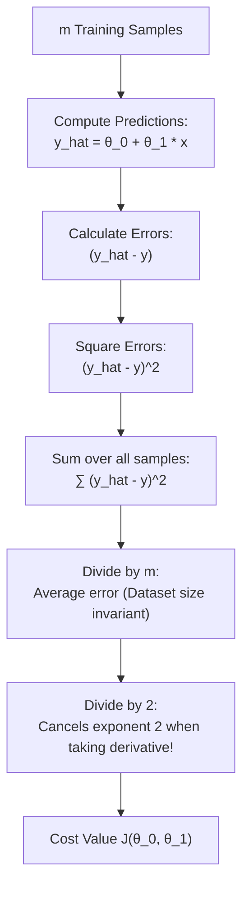

# Lecture 23.09: What is the Cost Function? (MSE & 1/(2m) Factor)

## 📌 Topic Overview
In this lecture, Shraddha ma'am formalizes the **Cost Function** $J(\theta_0, \theta_1)$ for linear regression, explaining why the mathematical formulation includes division by $m$ and the specific factor of $\frac{1}{2}$.

---

## 🏛️ Cost Function Formulation

For $m$ training samples and prediction $\hat{y}^{(i)} = \theta_0 + \theta_1 x^{(i)}$, the cost function is defined as:

$$
J(\theta_0, \theta_1) = \frac{1}{2m} \sum_{i=1}^m \left(\hat{y}^{(i)} - y^{(i)}\right)^2
$$



---

## 🔍 Why Divide by $2m$?
Shraddha ma'am highlights two critical mathematical reasons:

1. **Why divide by $m$?**
   If we only summed errors without dividing by $m$, a dataset with $1,000,000$ points would have a massive cost simply due to sample count. Dividing by $m$ gives the **average mean error per sample**, making the metric scale-invariant.

2. **Why the factor of $\frac{1}{2}$?**
   When computing partial derivatives during gradient descent, the power of $2$ comes down:

$$
\frac{\partial}{\partial \theta_1} \left[ \frac{1}{2} (\hat{y} - y)^2 \right] = \frac{1}{2} \cdot 2 \cdot (\hat{y} - y) \cdot \frac{\partial \hat{y}}{\partial \theta_1} = (\hat{y} - y) x
$$

The constant $\frac{1}{2}$ perfectly cancels the $2$, resulting in clean, elegant derivative formulas!

---

## 💻 Python Implementation

```python
import numpy as np

def compute_mse_cost_function(X, y, theta0, theta1):
    """
    Computes the Mean Squared Error (MSE) Cost Function J(theta0, theta1):
        J(theta0, theta1) = 1 / (2 * m) * sum_{i=1}^m (y_hat^{(i)} - y^{(i)})^2
    
    Args:
        X: 1D array of input features
        y: 1D array of actual target labels
        theta0: Intercept parameter (c)
        theta1: Slope parameter (m)
        
    Returns:
        float: Scalar cost value J
    """
    m = len(y)
    y_hat = theta0 + theta1 * np.array(X)
    squared_errors = (y_hat - np.array(y)) ** 2
    cost = (1.0 / (2.0 * m)) * np.sum(squared_errors)
    return float(cost)

# --- Function Call & Testing ---
x_samples = np.array([1.0, 2.0, 3.0, 4.0, 5.0])
y_samples = np.array([2.2, 2.8, 3.6, 4.5, 5.1])

# Evaluate cost across different candidate slopes (theta1) with theta0 fixed at 1.0
slopes = [0.2, 0.5, 0.8, 1.0, 1.2, 1.5]
print("Cost Function J(theta1) Evaluation (theta0 = 1.0):")
print(f"{'Slope theta1':<15} | {'Cost J(theta)':<15}")
print("-" * 32)
for s in slopes:
    c_val = compute_mse_cost_function(x_samples, y_samples, theta0=1.0, theta1=s)
    print(f"{s:<15.2f} | {c_val:<15.4f}")
```

---

## 🔑 Key Takeaways
1. The Cost Function $J(\theta)$ aggregates overall model error into a single scalar number.
2. The $1/m$ factor computes the mean; the $1/2$ factor mathematically cancels the power $2$ during differentiation.
3. Machine learning optimization is the mathematical search for the minimum of $J(\theta)$.
