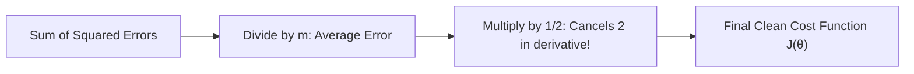

# Notes_23.09: Cost Function Kya Hota Hai? (1/2m Ka Raaz) [Hinglish]

## 📌 Topic Overview
Is lecture mein Shraddha ma'am ne **Cost Function** $J(\theta)$ ka formula derive kiya hai aur bataya hai ki formula mein **$m$ se divide kyu karte hain** aur aage **$1/2$ kyu lagaya jata hai**.

---

### 📋 Is Topic Mein Hum Kya Seekhenge?
- Cost Function $J(\theta_0, \theta_1)$ ka exact formula.
- $m$ (total samples) se divide karne ki zaroorat.
- $\frac{1}{2}$ factor lagane ka mathematical reason (Differentiation trick).
- Loss Function vs Cost Function ka farq.

---

### 🔍 Har Ek Point Ka Simple & Detailed Explanation

#### 1. Cost Function Ka Formula:

$$
J(\theta_0, \theta_1) = \frac{1}{2m} \sum_{i=1}^m \left(\hat{y}^{(i)} - y^{(i)}\right)^2
$$

- **Loss Function**: Kisi ek single sample ke error ko kehte hain ($(\hat{y}^{(i)} - y^{(i)})^2$).
- **Cost Function**: Poore dataset ke sabhi samples ke errors ke average ko kehte hain ($J(\theta)$).

#### 2. Formula Mein $2m$ Kyu Aata Hai?
- **$m$ se divide kyu kiya?**
  Agar 10 bacchon ka test loge toh total error kam hoga, agar 1 Lakh bacchon ka loge toh total error bohot bada ho jayega. Data bada hone se error artificially na badhe, isliye hum **average (Mean)** nikalne ke liye $m$ se divide karte hain.
- **$\frac{1}{2}$ kyu lagaya?**
  Kyunki jab hum calculus mein power rule lagakar derivative lete hain, toh power $2$ aage aati hai:

$$
\frac{d}{dx} [x^2] = 2x
$$

  Woh aage aane wala $2$ neeche wale $\frac{1}{2}$ se **cancel ho jata hai** ($2 \times \frac{1}{2} = 1$)! Is calculation ko aasan banane ke liye mathematicians pehle se hi $\frac{1}{2}$ laga dete hain.

---

### 📊 Visual Flowchart: 1/2m Ka Math



---

### 💻 Python Code

```python
import numpy as np

def compute_mse_cost_function(X, y, theta0, theta1):
    """
    Computes the Mean Squared Error (MSE) Cost Function J(theta0, theta1):
        J(theta0, theta1) = 1 / (2 * m) * sum_{i=1}^m (y_hat^{(i)} - y^{(i)})^2
    
    Args:
        X: 1D array of input features
        y: 1D array of actual target labels
        theta0: Intercept parameter (c)
        theta1: Slope parameter (m)
        
    Returns:
        float: Scalar cost value J
    """
    m = len(y)
    y_hat = theta0 + theta1 * np.array(X)
    squared_errors = (y_hat - np.array(y)) ** 2
    cost = (1.0 / (2.0 * m)) * np.sum(squared_errors)
    return float(cost)

# --- Function Call & Testing ---
x_samples = np.array([1.0, 2.0, 3.0, 4.0, 5.0])
y_samples = np.array([2.2, 2.8, 3.6, 4.5, 5.1])

# Evaluate cost across different candidate slopes (theta1) with theta0 fixed at 1.0
slopes = [0.2, 0.5, 0.8, 1.0, 1.2, 1.5]
print("Cost Function J(theta1) Evaluation (theta0 = 1.0):")
print(f"{'Slope theta1':<15} | {'Cost J(theta)':<15}")
print("-" * 32)
for s in slopes:
    c_val = compute_mse_cost_function(x_samples, y_samples, theta0=1.0, theta1=s)
    print(f"{s:<15.2f} | {c_val:<15.4f}")
```

---

### 📌 Summary Points
- Cost function poore model ki performance ka single score hota hai.
- $\frac{1}{2m}$ math ko clean aur scale-independent banata hai.
