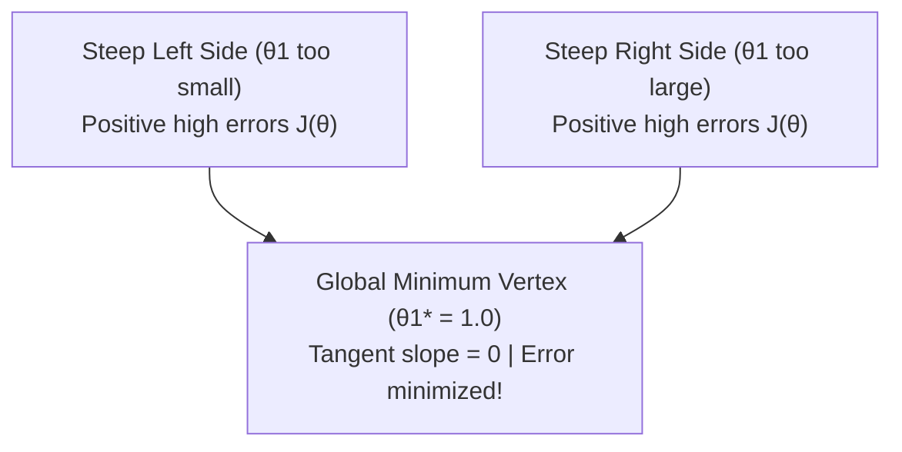

# Lecture 23.10: Understanding the Cost Function Curve (Convexity)

## 📌 Topic Overview
In this lecture, Shraddha ma'am plots the **Cost Function Curve**, proving why $J(\theta)$ takes the shape of a **strictly convex U-shaped parabola** (or a 3D bowl shape) with a single guaranteed global minimum.

---

## 🏛️ The U-Shaped Parabola

When plotting $J(\theta_1)$ versus slope $\theta_1$ (with $\theta_0 = 0$):



---

## 📐 Properties of Convex Cost Functions
1. **Convexity**: A function is strictly convex if any line segment connecting two points on the graph lies strictly above the curve.
2. **No Local Minima Traps**: A convex parabola has **only one stationary point**, which is guaranteed to be the unique **Global Minimum**.
3. **Slope Direction**:
   - To the left of the minimum: Slope $\frac{\partial J}{\partial \theta} < 0$ (negative).
   - To the right of the minimum: Slope $\frac{\partial J}{\partial \theta} > 0$ (positive).
   - Exactly at the minimum: Slope $\frac{\partial J}{\partial \theta} = 0$.

---

## 💻 Python Implementation

```python
import numpy as np

def generate_parabolic_cost_curve(x_data, y_data, theta1_range=None):
    """
    Computes Cost J(theta1) across a spectrum of candidate slopes
    assuming theta0 (intercept) = 0 for 2D parabolic visualization.
    Demonstrates that J(theta1) is a strictly convex U-shaped parabola.
    """
    if theta1_range is None:
        theta1_range = np.linspace(-1.0, 3.0, 21)
        
    x = np.array(x_data)
    y = np.array(y_data)
    m = len(y)
    
    costs = []
    for t1 in theta1_range:
        y_pred = t1 * x
        j_val = (1.0 / (2.0 * m)) * np.sum((y_pred - y) ** 2)
        costs.append(float(j_val))
        
    best_idx = int(np.argmin(costs))
    optimal_slope = float(theta1_range[best_idx])
    min_cost = float(costs[best_idx])
    
    return {
        'slopes': theta1_range.round(2).tolist(),
        'costs': np.array(costs).round(4).tolist(),
        'optimal_theta1': optimal_slope,
        'minimum_cost': min_cost
    }

# --- Function Call & Testing ---
# Ideal line: y = 1.0 * x (Points: (1,1), (2,2), (3,3))
pts_x = [1.0, 2.0, 3.0]
pts_y = [1.0, 2.0, 3.0]

curve = generate_parabolic_cost_curve(pts_x, pts_y)
print(f"Optimal Slope theta1* at Global Minimum : {curve['optimal_theta1']}")
print(f"Minimum Cost J(theta1*)                  : {curve['minimum_cost']:.4f}")
print()
print(f"{'Slope theta1':<15} | {'Cost J(theta1)':<15}")
print("-" * 32)
for s, c in zip(curve['slopes'][::4], curve['costs'][::4]):
    print(f"{s:<15.2f} | {c:<15.4f}")
```

---

## 🔑 Key Takeaways
1. The quadratic nature of Mean Squared Error guarantees a convex parabolic cost surface.
2. Optimization algorithms cannot get stuck in local minima when optimizing linear regression with MSE.
