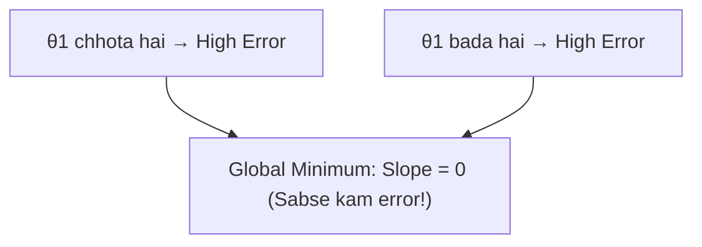

# Notes_23.10: Cost Function Ka Curve (Parabola Aur Convexity) [Hinglish]

## 📌 Topic Overview
Is lecture mein Shraddha ma'am ne **Cost Function ke Curve** ko plot karke dikhaya hai: kyu yeh curve ek **U-shaped katori (Parabola)** jaisa dikhta hai aur iska sabse nichla point global minimum kyu hota hai.

---

### 📋 Is Topic Mein Hum Kya Seekhenge?
- Cost Function ka graph kaisa dikhta hai (U-shape / Katori).
- Convex Function kya hota hai?
- Global Minimum vs Local Minima.
- Minimum point par slope hamesha 0 kyu hota hai.

---

### 🔍 Har Ek Point Ka Simple & Detailed Explanation

#### 1. U-Shaped Parabola Ki Intuition:
Maan lijiye hamare points $(1,1), (2,2), (3,3)$ hain jahan asli line ka slope $\theta_1 = 1$ hona chahiye:
- Agar hum slope $\theta_1 = 0$ rakhein: Line bohot neeche reh jayegi $\implies$ Error bohot zyada hoga!
- Agar hum slope $\theta_1 = 2$ rakhein: Line bohot oonchi nikal jayegi $\implies$ Error fir se bohot zyada hoga!
- Jab hum $\theta_1 = 1$ rakhenge: Line sabhi points ke theek upar baithegi $\implies$ **Error lagbhag 0 ho jayega**!

#### 2. Convexity Ka Faayda:
Yeh curve ek katori ki tarah hota hai. Katori mein agar aap koi kancha (marble) chhodte ho, toh woh ghum-fir kar hamesha katori ke **sabse nichle point (Global Minimum)** par hi rukega! Yahan koi doosra gaddha nahi hota jisme model phas sake.

---

### 📊 Visual Flowchart: Parabola Shape



---

### 💻 Python Code

```python
import numpy as np

def generate_parabolic_cost_curve(x_data, y_data, theta1_range=None):
    """
    Computes Cost J(theta1) across a spectrum of candidate slopes
    assuming theta0 (intercept) = 0 for 2D parabolic visualization.
    Demonstrates that J(theta1) is a strictly convex U-shaped parabola.
    """
    if theta1_range is None:
        theta1_range = np.linspace(-1.0, 3.0, 21)
        
    x = np.array(x_data)
    y = np.array(y_data)
    m = len(y)
    
    costs = []
    for t1 in theta1_range:
        y_pred = t1 * x
        j_val = (1.0 / (2.0 * m)) * np.sum((y_pred - y) ** 2)
        costs.append(float(j_val))
        
    best_idx = int(np.argmin(costs))
    optimal_slope = float(theta1_range[best_idx])
    min_cost = float(costs[best_idx])
    
    return {
        'slopes': theta1_range.round(2).tolist(),
        'costs': np.array(costs).round(4).tolist(),
        'optimal_theta1': optimal_slope,
        'minimum_cost': min_cost
    }

# --- Function Call & Testing ---
# Ideal line: y = 1.0 * x (Points: (1,1), (2,2), (3,3))
pts_x = [1.0, 2.0, 3.0]
pts_y = [1.0, 2.0, 3.0]

curve = generate_parabolic_cost_curve(pts_x, pts_y)
print(f"Optimal Slope theta1* at Global Minimum : {curve['optimal_theta1']}")
print(f"Minimum Cost J(theta1*)                  : {curve['minimum_cost']:.4f}")
print()
print(f"{'Slope theta1':<15} | {'Cost J(theta1)':<15}")
print("-" * 32)
for s, c in zip(curve['slopes'][::4], curve['costs'][::4]):
    print(f"{s:<15.2f} | {c:<15.4f}")
```

---

### 📌 Summary Points
- MSE Cost function hamesha convex U-shaped parabola banata hai.
- Sabse nichle point par derivative zero hota hai aur error minimum.
