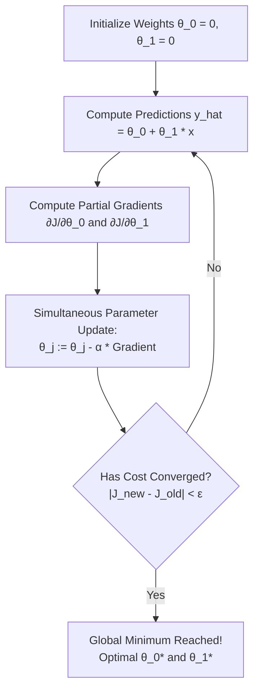

# Lecture 23.11: What is Gradient Descent in Linear Regression?

## 📌 Topic Overview
In this lecture, Shraddha ma'am introduces **Gradient Descent**, the core optimization algorithm that iteratively tunes model parameters to locate the global minimum of the cost function.

---

## 🏛️ The Gradient Descent Update Equations

For parameters $\theta_0$ (bias) and $\theta_1$ (weight), the simultaneous update rule is:

$$
\theta_0 := \theta_0 - \alpha \frac{\partial J}{\partial \theta_0} = \theta_0 - \frac{\alpha}{m} \sum_{i=1}^m \left(\hat{y}^{(i)} - y^{(i)}\right)
$$

$$
\theta_1 := \theta_1 - \alpha \frac{\partial J}{\partial \theta_1} = \theta_1 - \frac{\alpha}{m} \sum_{i=1}^m \left(\hat{y}^{(i)} - y^{(i)}\right) x^{(i)}
$$

Where $\alpha > 0$ is the **Learning Rate**.



---

## ⚙️ The Critical Role of Learning Rate $\alpha$
1. **$\alpha$ Too Small**: Tiny steps lead to exceptionally slow convergence.
2. **$\alpha$ Too Large**: Can overshoot the valley floor, oscillate wildly, or completely diverge ($\infty$).
3. **$\alpha$ Well-Tuned**: Smoothly converges to the global minimum.

---

## 💻 Python Implementation

```python
import numpy as np

def run_gradient_descent_linear_regression(X, y, lr=0.01, epochs=500):
    """
    Executes simultaneous batch Gradient Descent updates for Linear Regression:
        theta0 := theta0 - alpha * (1/m) * sum(y_hat - y)
        theta1 := theta1 - alpha * (1/m) * sum((y_hat - y) * x)
        
    Args:
        X: 1D array of feature values
        y: 1D array of target labels
        lr: Learning rate alpha
        epochs: Number of optimization iterations
        
    Returns:
        dict: Final theta0, theta1, final cost, and training trajectory
    """
    x_arr = np.array(X, dtype=float)
    y_arr = np.array(y, dtype=float)
    m = len(y_arr)
    
    # Initialize parameters randomly or at zero
    theta0 = 0.0
    theta1 = 0.0
    
    cost_history = []
    
    for epoch in range(epochs):
        # 1. Forward hypothesis
        y_hat = theta0 + theta1 * x_arr
        
        # 2. Compute cost
        cost = (1.0 / (2.0 * m)) * np.sum((y_hat - y_arr) ** 2)
        cost_history.append(cost)
        
        # 3. Compute partial gradients
        grad0 = (1.0 / m) * np.sum(y_hat - y_arr)
        grad1 = (1.0 / m) * np.sum((y_hat - y_arr) * x_arr)
        
        # 4. Simultaneous parameter update
        theta0 = theta0 - lr * grad0
        theta1 = theta1 - lr * grad1
        
    return {
        'theta0_intercept': theta0,
        'theta1_slope': theta1,
        'final_cost': cost_history[-1],
        'initial_cost': cost_history[0]
    }

# --- Function Call & Testing ---
# Synthetic data with known relationship: y = 2.0 * x + 1.0
x_train = [1, 2, 3, 4, 5]
y_train = [3.0, 5.0, 7.0, 9.0, 11.0]

gd_result = run_gradient_descent_linear_regression(x_train, y_train, lr=0.05, epochs=1000)
print(f"Initial Cost at (0, 0) : {gd_result['initial_cost']:.4f}")
print(f"Learned Intercept (θ0) : {gd_result['theta0_intercept']:.4f} (True: 1.0)")
print(f"Learned Slope (θ1)     : {gd_result['theta1_slope']:.4f} (True: 2.0)")
print(f"Final Optimized Cost   : {gd_result['final_cost']:.6e}")
```

---

## 🔑 Key Takeaways
1. Gradient Descent moves parameters in the opposite direction of the gradient slope.
2. Both $\theta_0$ and $\theta_1$ MUST be updated **simultaneously** within each iteration.
3. As the model approaches the minimum, gradients naturally shrink, allowing the algorithm to automatically take smaller steps without changing $\alpha$.
