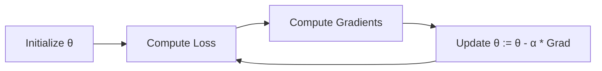

# Notes_23.11: Gradient Descent Kya Hota Hai? [Hinglish]

## 📌 Topic Overview
Is lecture mein Shraddha ma'am ne **Gradient Descent** algorithm ka live blackboard demonstration diya hai: kaise yeh algorithm andhere mein pahadi se neeche utarne ki tarah step-by-step best weights dhoondta hai.

---

### 📋 Is Topic Mein Hum Kya Seekhenge?
- Gradient Descent ki visual intuition (Pahadi se gaddhe mein utarna).
- Parameters update ka mathematical formula.
- Learning Rate ($\alpha$) ka role (chhota vs bada $\alpha$).
- Simultaneous update kyu zaroori hai?

---

### 🔍 Har Ek Point Ka Simple & Detailed Explanation

#### 1. Blindfolded Hiker Analogy:
Maan lijiye aapki aankhon par patti bandhi hai aur aapko pahadi se neeche gaddhe (Valley) mein aana hai:
1. Aap pair se zameen ka slope mehsoos karte ho.
2. Jis taraf dhalan neeche ja rahi hoti hai, aap us taraf ek kadam badhate ho.
3. Yeh step baar-baar repeat karte ho jab tak bilkul flat zameen (Slope = 0) na aa jaye!
Yahi kaam **Gradient Descent** karta hai:

$$
\theta_j := \theta_j - \alpha \frac{\partial J}{\partial \theta_j}
$$

#### 2. Learning Rate ($\alpha$) Ka Faisla:
- **$\alpha$ bohot chhota hai**: Aap cheenti ki chaal chaloge, pahadi se utarne mein saal lag jayenge (Slow convergence).
- **$\alpha$ bohot bada hai**: Aap itni lambi chhalang maroge ki gaddhe ko cross karke doosre pahaad par gir jaoge (Overshoot / Diverge).
- **$\alpha$ balanced hai**: Perfect speed se minimum tak pahunchoge.

---

### 📊 Visual Flowchart: 4-Step Cycle



---

### 💻 Python Code

```python
import numpy as np

def run_gradient_descent_linear_regression(X, y, lr=0.01, epochs=500):
    """
    Executes simultaneous batch Gradient Descent updates for Linear Regression:
        theta0 := theta0 - alpha * (1/m) * sum(y_hat - y)
        theta1 := theta1 - alpha * (1/m) * sum((y_hat - y) * x)
        
    Args:
        X: 1D array of feature values
        y: 1D array of target labels
        lr: Learning rate alpha
        epochs: Number of optimization iterations
        
    Returns:
        dict: Final theta0, theta1, final cost, and training trajectory
    """
    x_arr = np.array(X, dtype=float)
    y_arr = np.array(y, dtype=float)
    m = len(y_arr)
    
    # Initialize parameters randomly or at zero
    theta0 = 0.0
    theta1 = 0.0
    
    cost_history = []
    
    for epoch in range(epochs):
        # 1. Forward hypothesis
        y_hat = theta0 + theta1 * x_arr
        
        # 2. Compute cost
        cost = (1.0 / (2.0 * m)) * np.sum((y_hat - y_arr) ** 2)
        cost_history.append(cost)
        
        # 3. Compute partial gradients
        grad0 = (1.0 / m) * np.sum(y_hat - y_arr)
        grad1 = (1.0 / m) * np.sum((y_hat - y_arr) * x_arr)
        
        # 4. Simultaneous parameter update
        theta0 = theta0 - lr * grad0
        theta1 = theta1 - lr * grad1
        
    return {
        'theta0_intercept': theta0,
        'theta1_slope': theta1,
        'final_cost': cost_history[-1],
        'initial_cost': cost_history[0]
    }

# --- Function Call & Testing ---
# Synthetic data with known relationship: y = 2.0 * x + 1.0
x_train = [1, 2, 3, 4, 5]
y_train = [3.0, 5.0, 7.0, 9.0, 11.0]

gd_result = run_gradient_descent_linear_regression(x_train, y_train, lr=0.05, epochs=1000)
print(f"Initial Cost at (0, 0) : {gd_result['initial_cost']:.4f}")
print(f"Learned Intercept (θ0) : {gd_result['theta0_intercept']:.4f} (True: 1.0)")
print(f"Learned Slope (θ1)     : {gd_result['theta1_slope']:.4f} (True: 2.0)")
print(f"Final Optimized Cost   : {gd_result['final_cost']:.6e}")
```

---

### 📌 Summary Points
- Gradient descent negative slope ki taraf kadam badhata hai.
- Dono parameters ($\theta_0, \theta_1$) ek sath update hone chahiye.
