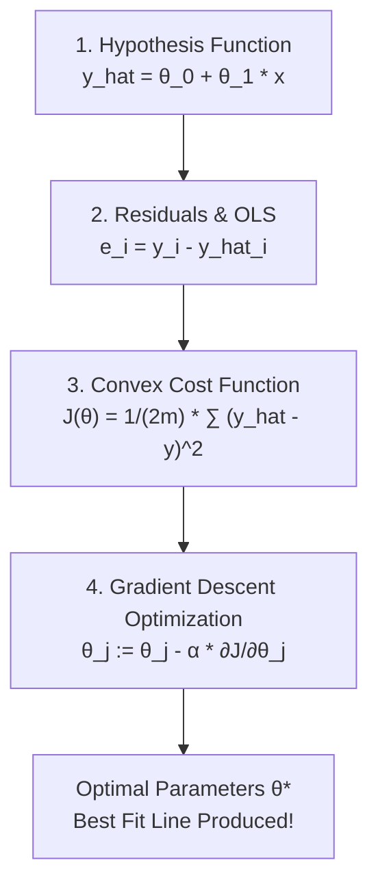

# Lecture 23.12: Summary of Linear Regression Foundations

## 📌 Topic Overview
In this lecture, Shraddha ma'am synthesizes the entire mathematical framework of **Linear Regression**, connecting the linear hypothesis, ordinary least squares, the convex cost surface, and gradient descent into one unified system.

---

## 🏛️ The Complete Linear Regression System



---

## ⚖️ Foundational Pillars Matrix

| Pillar | Mathematical Formula | Purpose |
| :--- | :--- | :--- |
| **Hypothesis** | $\hat{y} = \theta_0 + \theta_1 x$ | Maps input feature to predicted continuous value |
| **Residual** | $e_i = y_i - \hat{y}_i$ | Quantifies individual sample prediction error |
| **Cost Function** | $J(\theta) = \frac{1}{2m} \sum e_i^2$ | Computes average global discrepancy across dataset |
| **Optimization** | $\theta_j := \theta_j - \alpha \frac{\partial J}{\partial \theta_j}$ | Iteratively guides weights towards global minimum |

---

## 💻 Python Implementation

```python
def summarize_linear_regression_foundations():
    """
    Summarizes the 4 foundational pillars of Linear Regression:
    1. Hypothesis Function: y_hat = theta0 + theta1*x
    2. Residual Metric: e_i = y_i - y_hat_i
    3. Objective Cost Function: J(theta) = 1/(2m) * sum(e_i^2)
    4. Optimization Algorithm: Simultaneous Gradient Descent
    """
    summary = {
        'Hypothesis': 'Linear straight-line model: y_hat = theta0 + theta1*x',
        'Loss Metric': 'Squared error per sample: (y_hat - y)^2',
        'Cost Function': 'Mean squared error averaged over m samples: 1/(2m) * sum(error^2)',
        'Optimization': 'Gradient descent updates: theta_j := theta_j - alpha * (dJ/dtheta_j)',
        'Convexity': 'MSE loss surface is strictly convex (guaranteed single global minimum)'
    }
    return summary

# --- Function Call & Testing ---
pillars = summarize_linear_regression_foundations()
print("Linear Regression Theoretical Foundations:")
for k, v in pillars.items():
    print(f" * {k:<15}: {v}")
```

---

## 🔑 Key Takeaways
1. Linear Regression consists of four tightly coupled components: hypothesis, residuals, cost function, and optimization.
2. Because MSE is convex, Gradient Descent will always reach the global minimum if $\alpha$ is appropriately set.
