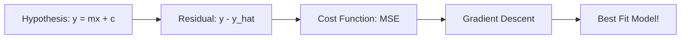

# Notes_23.12: Linear Regression Ka Complete Summary [Hinglish]

## 📌 Topic Overview
Is lecture mein Shraddha ma'am ne **Linear Regression ke poore theoretical concepts** ko ek jagah summarize kiya hai taaki interview aur coding implementation se pehle saare dots connect ho sakein.

---

### 📋 Is Topic Mein Hum Kya Seekhenge?
- Linear Regression ke 4 mukhya pillars ka recap.
- Hypothesis $\to$ Residuals $\to$ Cost Function $\to$ Gradient Descent ka connection.
- Summary table aur core formulas.

---

### 🔍 Har Ek Point Ka Simple & Detailed Explanation

#### 1. Chaar Mukhya Pillars:
1. **Hypothesis**: Straight line equation $\hat{y} = \theta_0 + \theta_1 x$.
2. **Residual**: Asli point aur prediction ka vertical difference ($y - \hat{y}$).
3. **Cost Function**: Poore dataset ke errors ka average ($J(\theta) = \frac{1}{2m} \sum (y - \hat{y})^2$).
4. **Gradient Descent**: Katori ke sabse nichle point tak pahunchne ka iterative algorithm.

---

### 📊 Visual Flowchart: Summary Architecture



---

### 💻 Python Code

```python
def summarize_linear_regression_foundations():
    """
    Summarizes the 4 foundational pillars of Linear Regression:
    1. Hypothesis Function: y_hat = theta0 + theta1*x
    2. Residual Metric: e_i = y_i - y_hat_i
    3. Objective Cost Function: J(theta) = 1/(2m) * sum(e_i^2)
    4. Optimization Algorithm: Simultaneous Gradient Descent
    """
    summary = {
        'Hypothesis': 'Linear straight-line model: y_hat = theta0 + theta1*x',
        'Loss Metric': 'Squared error per sample: (y_hat - y)^2',
        'Cost Function': 'Mean squared error averaged over m samples: 1/(2m) * sum(error^2)',
        'Optimization': 'Gradient descent updates: theta_j := theta_j - alpha * (dJ/dtheta_j)',
        'Convexity': 'MSE loss surface is strictly convex (guaranteed single global minimum)'
    }
    return summary

# --- Function Call & Testing ---
pillars = summarize_linear_regression_foundations()
print("Linear Regression Theoretical Foundations:")
for k, v in pillars.items():
    print(f" * {k:<15}: {v}")
```

---

### 📌 Summary Points
- Saare theoretical concepts ek doosre se jude hue hain.
- Model training ka matlab sirf Cost Function ko minimize karna hai.
