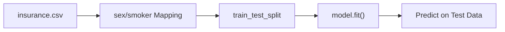

# Notes_23.13: Linear Regression Hands-On (Insurance Dataset) [Hinglish]

## 📌 Topic Overview
Is lecture mein Shraddha ma'am ne Jupyter Notebook par **Medical Insurance Dataset** (`insurance.csv`) lekar Linear Regression ka complete live implementation karke dikhaya hai.

---

### 📋 Is Topic Mein Hum Kya Seekhenge?
- `insurance.csv` ko pandas se load karna.
- Categorical features (`sex`, `smoker`) ko numbers ($0$ aur $1$) mein map karna.
- 80% Train aur 20% Test split karna.
- `LinearRegression()` model fit karna aur coefficients check karna.

---

### 🔍 Har Ek Point Ka Simple & Detailed Explanation

#### 1. Data Preprocessing:
Dataset mein `sex` ('male', 'female') aur `smoker` ('yes', 'no') text format mein the:
- `sex`: `female` $\to 1$, `male` $\to 0$
- `smoker`: `yes` $\to 1$, `no` $\to 0$

#### 2. Coefficients Ka Matlab:
Model fit karne ke baad jab ma'am ne `model.coef_` print kiya, toh pata chala:
- `smoker` ka coefficient sabse bada (₹24,000+) nikla! Iska matlab smoking karne walo ka medical bill sabse zyada aata hai.
- `age` aur `bmi` badhne se bhi bill dheere-dheere badhta hai.

---

### 📊 Visual Flowchart: Implementation Pipeline



---

### 💻 Python Code

```python
import pandas as pd
import numpy as np
from sklearn.model_selection import train_test_split
from sklearn.linear_model import LinearRegression

def train_linear_regression_pipeline(data_path=None):
    """
    Trains a multi-variable Linear Regression model on the classroom Insurance dataset
    as demonstrated by Shraddha ma'am in video lecture 23.13.
    
    Predicts medical insurance 'charges' based on age, bmi, children, sex, and smoker status.
    """
    # 1. Load or synthesize insurance data
    if data_path and os.path.exists(data_path):
        df = pd.read_csv(data_path)
    else:
        # Fallback synthetic insurance data matching schema
        np.random.seed(42)
        n = 300
        df = pd.DataFrame({
            'age': np.random.randint(18, 65, size=n),
            'sex': np.random.choice(['female', 'male'], size=n),
            'bmi': np.random.uniform(18.0, 45.0, size=n),
            'children': np.random.randint(0, 5, size=n),
            'smoker': np.random.choice(['yes', 'no'], p=[0.2, 0.8], size=n),
            'charges': np.zeros(n)
        })
        # Synthetic charges generation
        df['charges'] = (
            250 * df['age'] + 
            330 * df['bmi'] + 
            500 * df['children'] + 
            24000 * (df['smoker'] == 'yes') + 
            np.random.normal(0, 1500, size=n)
        )

    # 2. Preprocess & Encode binary categoricals
    X = df.drop(columns=['charges'], errors='ignore')
    if 'region' in X.columns:
        X = X.drop(columns=['region'])
    y = df['charges']

    if 'sex' in X.columns and X['sex'].dtype == object:
        X['sex'] = X['sex'].map({'female': 1, 'male': 0})
    if 'smoker' in X.columns and X['smoker'].dtype == object:
        X['smoker'] = X['smoker'].map({'yes': 1, 'no': 0})

    # 3. Train-Test Split (80/20)
    X_train, X_test, y_train, y_test = train_test_split(
        X, y, test_size=0.20, random_state=42
    )

    # 4. Fit Scikit-Learn LinearRegression
    model = LinearRegression()
    model.fit(X_train, y_train)

    # 5. Predict
    y_pred = model.predict(X_test)

    return {
        'model': model,
        'features': X.columns.tolist(),
        'coefficients': model.coef_.tolist(),
        'intercept': float(model.intercept_),
        'sample_actual': y_test.iloc[:3].values.tolist(),
        'sample_pred': y_pred[:3].tolist()
    }

# --- Function Call & Testing ---
res = train_linear_regression_pipeline()
print(f"Learned Intercept (Bias): Rs {res['intercept']:,.2f}")
print("Learned Feature Coefficients:")
for feat, coef in zip(res['features'], res['coefficients']):
    print(f"  {feat:<12} : {coef:>10.2f}")
print()
print("Sample Test Predictions:")
for act, pred in zip(res['sample_actual'], res['sample_pred']):
    print(f"  Actual: Rs {act:,.2f} | Predicted: Rs {pred:,.2f}")
```

---

### 📌 Summary Points
- Text columns ko hamesha numbers mein map karein.
- `model.coef_` se features ki importance samajh aati hai.
