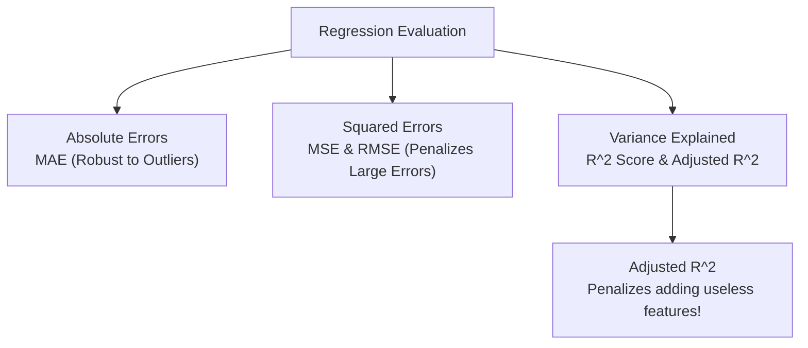

# Lecture 23.14: Evaluation Metrics for Regression

## 📌 Topic Overview
In this concluding lecture for Day 23, Shraddha ma'am covers all essential **Regression Evaluation Metrics**: **MAE**, **MSE**, **RMSE**, **$R^2$ Score**, and **Adjusted $R^2$**.

---

## 🏛️ Comprehensive Metrics Formulations

### 1. Mean Absolute Error (MAE)

$$
\text{MAE} = \frac{1}{m} \sum_{i=1}^m \left| y_i - \hat{y}_i \right|
$$

- In the original units of $y$. Robust to extreme outliers.

### 2. Mean Squared Error (MSE) & Root Mean Squared Error (RMSE)

$$
\text{MSE} = \frac{1}{m} \sum_{i=1}^m \left( y_i - \hat{y}_i \right)^2, \quad \text{RMSE} = \sqrt{\text{MSE}}
$$

- RMSE converts the squared metric back into the original units of the target variable.

### 3. $R^2$ Score (Coefficient of Determination)

$$
R^2 = 1 - \frac{\text{SS}_{\text{res}}}{\text{SS}_{\text{tot}}} = 1 - \frac{\sum (y_i - \hat{y}_i)^2}{\sum (y_i - \bar{y})^2}
$$

- Measures the proportion of variance in $y$ explained by the features ($1.0$ is perfect; $0.0$ equals baseline mean predictor).

### 4. Adjusted $R^2$

$$
R^2_{\text{adj}} = 1 - \left[ \frac{(1 - R^2)(n - 1)}{n - p - 1} \right]
$$

- **Why Adjusted $R^2$?** Adding irrelevant garbage features will *always* mechanically inflate raw $R^2$. Adjusted $R^2$ penalizes model complexity by including feature count $p$ in the denominator!

---

## 📊 Metrics Flowchart



---

## 💻 Python Implementation

```python
import numpy as np
from sklearn.metrics import mean_absolute_error, mean_squared_error, r2_score

def compute_regression_metrics(y_true, y_pred, num_features):
    """
    Computes all standard regression evaluation metrics:
    1. MAE (Mean Absolute Error)
    2. MSE (Mean Squared Error)
    3. RMSE (Root Mean Squared Error)
    4. R^2 (Coefficient of Determination)
    5. Adjusted R^2 (Penalizes redundant features)
    """
    y_t = np.array(y_true)
    y_p = np.array(y_pred)
    n = len(y_t)
    p = num_features
    
    mae = mean_absolute_error(y_t, y_p)
    mse = mean_squared_error(y_t, y_p)
    rmse = np.sqrt(mse)
    r2 = r2_score(y_t, y_p)
    
    # Adjusted R^2 formula
    adj_r2 = 1.0 - ((1.0 - r2) * (n - 1) / (n - p - 1))
    
    return {
        'MAE': float(mae),
        'MSE': float(mse),
        'RMSE': float(rmse),
        'R2_Score': float(r2),
        'Adjusted_R2': float(adj_r2)
    }

# --- Function Call & Testing ---
actuals = [100.0, 150.0, 200.0, 250.0, 300.0]
preds   = [105.0, 142.0, 208.0, 245.0, 310.0]

metrics = compute_regression_metrics(actuals, preds, num_features=2)
print("Regression Evaluation Metrics:")
print(f"  MAE         : {metrics['MAE']:.2f}")
print(f"  MSE         : {metrics['MSE']:.2f}")
print(f"  RMSE        : {metrics['RMSE']:.2f}")
print(f"  R^2 Score   : {metrics['R2_Score']:.4f}")
print(f"  Adjusted R^2: {metrics['Adjusted_R2']:.4f}")
```

---

## 🔑 Key Takeaways
1. MAE measures average magnitude; RMSE penalizes large blunders.
2. $R^2$ tells you what percentage of target variance your model captures.
3. Always report Adjusted $R^2$ when performing feature selection to detect useless predictors.
