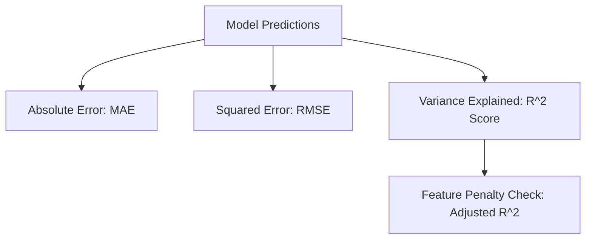

# Notes_23.14: Regression Ke Evaluation Metrics [Hinglish]

## 📌 Topic Overview
Is final lecture mein Shraddha ma'am ne Regression models ko test karne ke sabhi zaroori **Evaluation Metrics** (MAE, MSE, RMSE, $R^2$ aur Adjusted $R^2$) ko detail mein samjhaya hai.

---

### 📋 Is Topic Mein Hum Kya Seekhenge?
- MAE (Mean Absolute Error) aur RMSE ka antar.
- $R^2$ Score kya hota hai aur iski range (0 se 1).
- Raw $R^2$ ka dhoka: Faltu features add karne se $R^2$ kyu badhta hai?
- **Adjusted $R^2$** kyu sabse behtar metric hai.

---

### 🔍 Har Ek Point Ka Simple & Detailed Explanation

#### 1. MAE vs RMSE:
- **MAE**: Sidha average error. Agar actual ₹100 tha aur prediction ₹105 tha, toh error ₹5 hai.
- **RMSE**: Outliers ko pakadne ke liye errors ka square karke root lete hain. Agar model ne koi bohot badi galti ki hai, toh RMSE turant badh jata hai.

#### 2. $R^2$ Score (Variance Explained):
Yeh batata hai ki aapke model ne target data ka kitna percentage pattern samajh liya hai:
- $R^2 = 1.0$: 100% Perfect prediction.
- $R^2 = 0.80$: Model ne 80% pattern samajh liya, 20% noise hai.

#### 3. Adjusted $R^2$ Kyu Zaroori Hai?
Agar aap house price model mein faltu features (jaise "owner ke kutte ka naam") add kar doge, tab bhi raw $R^2$ thoda sa badh jayega!
Is dhoke se bachne ke liye **Adjusted $R^2$** use karte hain:

$$
R^2_{\text{adj}} = 1 - \left[ \frac{(1 - R^2)(n - 1)}{n - p - 1} \right]
$$

Agar naya feature model ko koi asli faayda nahi de raha hai, toh Adjusted $R^2$ **kam ho jata hai**!

---

### 📊 Visual Flowchart: Metrics Selection



---

### 💻 Python Code

```python
import numpy as np
from sklearn.metrics import mean_absolute_error, mean_squared_error, r2_score

def compute_regression_metrics(y_true, y_pred, num_features):
    """
    Computes all standard regression evaluation metrics:
    1. MAE (Mean Absolute Error)
    2. MSE (Mean Squared Error)
    3. RMSE (Root Mean Squared Error)
    4. R^2 (Coefficient of Determination)
    5. Adjusted R^2 (Penalizes redundant features)
    """
    y_t = np.array(y_true)
    y_p = np.array(y_pred)
    n = len(y_t)
    p = num_features
    
    mae = mean_absolute_error(y_t, y_p)
    mse = mean_squared_error(y_t, y_p)
    rmse = np.sqrt(mse)
    r2 = r2_score(y_t, y_p)
    
    # Adjusted R^2 formula
    adj_r2 = 1.0 - ((1.0 - r2) * (n - 1) / (n - p - 1))
    
    return {
        'MAE': float(mae),
        'MSE': float(mse),
        'RMSE': float(rmse),
        'R2_Score': float(r2),
        'Adjusted_R2': float(adj_r2)
    }

# --- Function Call & Testing ---
actuals = [100.0, 150.0, 200.0, 250.0, 300.0]
preds   = [105.0, 142.0, 208.0, 245.0, 310.0]

metrics = compute_regression_metrics(actuals, preds, num_features=2)
print("Regression Evaluation Metrics:")
print(f"  MAE         : {metrics['MAE']:.2f}")
print(f"  MSE         : {metrics['MSE']:.2f}")
print(f"  RMSE        : {metrics['RMSE']:.2f}")
print(f"  R^2 Score   : {metrics['R2_Score']:.4f}")
print(f"  Adjusted R^2: {metrics['Adjusted_R2']:.4f}")
```

---

### 📌 Summary Points
- Business ko error samjhane ke liye **MAE / RMSE** best hain.
- Model comparison ke liye **Adjusted $R^2$** sabse reliable metric hai.
