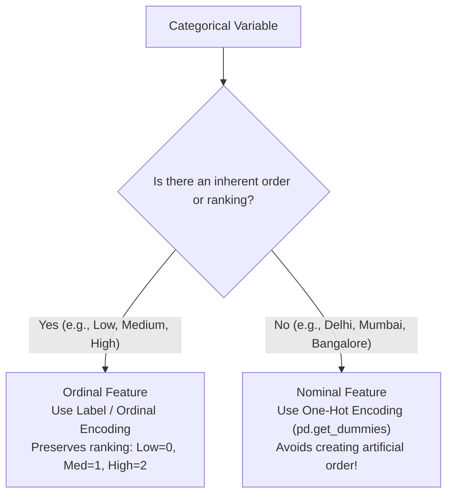

# Lecture 24.01: Feature Engineering — Categorical Encoding

## 📌 Topic Overview
In this lecture, Shraddha ma'am introduces **Feature Engineering for Categorical Data**, explaining how to convert text attributes into numerical matrices using **Label Encoding** and **One-Hot Encoding**.

---

## 🏛️ Nominal vs Ordinal Categorical Data



---

## 💡 Why One-Hot Encoding for Nominal Data?
If you assign `Delhi = 1`, `Mumbai = 2`, `Bangalore = 3`, linear regression will mathematically assume:

$$
\text{Bangalore} = 3 \times \text{Delhi} \quad \text{and} \quad \text{Mumbai} - \text{Delhi} = \text{Bangalore} - \text{Mumbai}
$$

This creates non-existent arithmetic relationships! One-Hot Encoding solves this by creating distinct binary dimensions where all cities are orthogonal and equidistant.

---

## 💻 Python Implementation

```python
import pandas as pd
from sklearn.preprocessing import LabelEncoder

def demonstrate_categorical_encoding():
    """
    Demonstrates the two core categorical encoding methods:
    1. Label Encoding: Maps ordered categories to integer ranks [0, 1, 2] (Ordinal)
    2. One-Hot Encoding: Creates separate binary indicator columns (Nominal)
    """
    data = pd.DataFrame({
        'Education': ['High School', 'Bachelor', 'Master', 'Bachelor'],  # Ordinal
        'City': ['Delhi', 'Mumbai', 'Bangalore', 'Delhi']               # Nominal
    })
    
    # 1. Label Encoding for Ordinal Education
    le = LabelEncoder()
    data['Education_Encoded'] = le.fit_transform(data['Education'])
    
    # 2. One-Hot Encoding for Nominal City
    ohe_data = pd.get_dummies(data, columns=['City'], drop_first=False, dtype=int)
    
    return ohe_data

# --- Function Call & Testing ---
encoded_df = demonstrate_categorical_encoding()
print("Encoded DataFrame with Label and One-Hot Encoding:")
print(encoded_df)
```

---

## 🔑 Key Takeaways
1. Machine learning models require numerical matrices; text categories cannot be fed directly into estimators.
2. Use Label Encoding only when features possess a genuine natural order (e.g., Education levels, T-shirt sizes).
3. Use One-Hot Encoding for nominal attributes with no inherent ranking.
