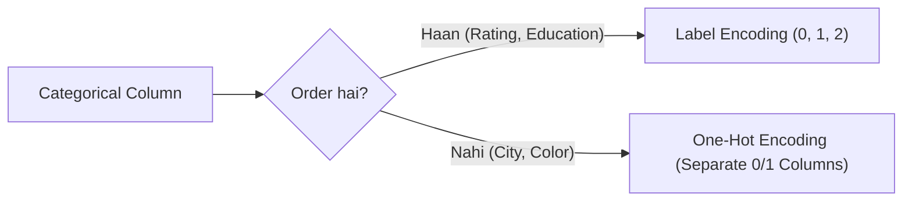

# Notes_24.01: Categorical Encoding (Text Se Numbers Banana) [Hinglish]

## 📌 Topic Overview
Is lecture mein Shraddha ma'am ne **Feature Engineering** ka sabse pehla aur zaroori step samjhaya hai: text columns (jaise City ya Education) ko machine learning ke liye numbers mein kaise convert karte hain.

---

### 📋 Is Topic Mein Hum Kya Seekhenge?
- Nominal vs Ordinal data ka farq.
- Label Encoding kab lagate hain (Ordinal data ke liye).
- One-Hot Encoding (`pd.get_dummies`) kab lagate hain (Nominal data ke liye).
- Agar nominal data par Label encoding laga di toh kya galti hoti hai?

---

### 🔍 Har Ek Point Ka Simple & Detailed Explanation

#### 1. Nominal vs Ordinal Data:
- **Ordinal Data**: Jahan ek order ya ranking hoti hai (jaise: Poor, Average, Good ya Low, Medium, High). Yahan hum 0, 1, 2 assign kar sakte hain kyunki High > Medium > Low hota hai.
- **Nominal Data**: Jahan koi ranking nahi hoti (jaise: Red, Blue, Green ya Delhi, Mumbai, Pune). Yahan Delhi kisi se "bada" ya "chhota" nahi hota.

#### 2. Label Encoding Ka Dhoka:
Agar aap Delhi ko 1 aur Mumbai ko 2 aur Bangalore ko 3 bana doge:
Toh Linear Regression ka formula sochega ki Bangalore Delhi se teen guna bada hai ($3 \times 1 = 3$)! Yeh bilkul galat logic hai.
Isliye nominal data ke liye **One-Hot Encoding** lagate hain jisme har city ka alag $0/1$ column ban jata hai.

---

### 📊 Visual Flowchart: Encoding Strategy



---

### 💻 Python Code

```python
import pandas as pd
from sklearn.preprocessing import LabelEncoder

def demonstrate_categorical_encoding():
    """
    Demonstrates the two core categorical encoding methods:
    1. Label Encoding: Maps ordered categories to integer ranks [0, 1, 2] (Ordinal)
    2. One-Hot Encoding: Creates separate binary indicator columns (Nominal)
    """
    data = pd.DataFrame({
        'Education': ['High School', 'Bachelor', 'Master', 'Bachelor'],  # Ordinal
        'City': ['Delhi', 'Mumbai', 'Bangalore', 'Delhi']               # Nominal
    })
    
    # 1. Label Encoding for Ordinal Education
    le = LabelEncoder()
    data['Education_Encoded'] = le.fit_transform(data['Education'])
    
    # 2. One-Hot Encoding for Nominal City
    ohe_data = pd.get_dummies(data, columns=['City'], drop_first=False, dtype=int)
    
    return ohe_data

# --- Function Call & Testing ---
encoded_df = demonstrate_categorical_encoding()
print("Encoded DataFrame with Label and One-Hot Encoding:")
print(encoded_df)
```

---

### 📌 Summary Points
- Text columns ko numbers banana zaroori hota hai.
- Order ho toh Label Encoding, order na ho toh One-Hot Encoding.
