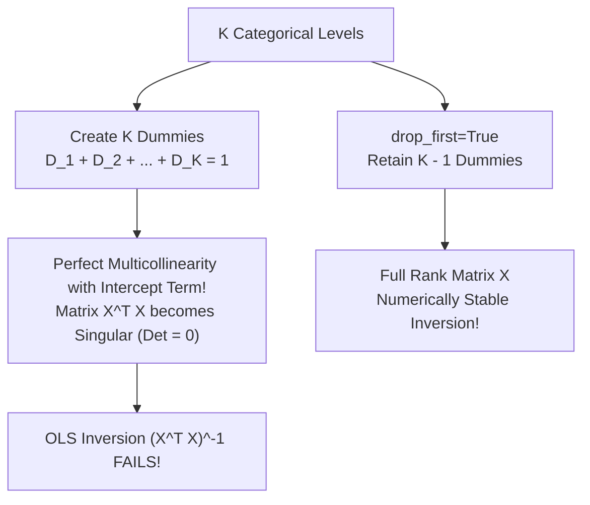

# Lecture 24.02: The Dummy Variable Trap & Multicollinearity

## 📌 Topic Overview
In this lecture, Shraddha ma'am explains the **Dummy Variable Trap**, a fatal mathematical trap where One-Hot Encoding introduces **perfect multicollinearity** into linear regression models, and demonstrates how `drop_first=True` resolves it.

---

## 🏛️ What is the Dummy Variable Trap?

When a categorical feature has $k$ distinct categories, One-Hot Encoding creates $k$ dummy variables: $D_1, D_2, \dots, D_k$.

Notice that for every row, exactly one dummy equals $1$ and all others equal $0$:

$$
D_1 + D_2 + \dots + D_k = 1
$$

This means any single dummy variable can be written as a perfect linear combination of the remaining variables:

$$
D_k = 1 - \sum_{j=1}^{k-1} D_j
$$



---

## 🛠️ The Solution: Drop the First Column
To eliminate multicollinearity, we always drop one reference category:
- For $k$ categories, we keep exactly **$k - 1$ dummy columns**.
- When all $k - 1$ dummies are $0$, the model knows by default that the sample belongs to the dropped base category!
- In pandas: `pd.get_dummies(df, drop_first=True)`.

---

## 💻 Python Implementation

```python
import pandas as pd

def demonstrate_dummy_variable_trap():
    """
    Demonstrates the Dummy Variable Trap and its resolution:
    If a category has K distinct values, One-Hot Encoding creates K dummy columns.
    Since sum(dummies) = 1, one dummy column is perfectly predictable from the others:
        D_k = 1 - sum_{j=1}^{k-1} D_j
    This causes Perfect Multicollinearity and breaks Matrix Inversion (X^T X)^-1.
    
    Resolution: Always use pd.get_dummies(..., drop_first=True) to retain (K-1) dummies.
    """
    df = pd.DataFrame({
        'Gender': ['Male', 'Female', 'Female', 'Male'],
        'Salary': [50000, 60000, 55000, 52000]
    })
    
    # 1. Trapped OHE (K dummies for K classes => Multicollinear!)
    trapped_ohe = pd.get_dummies(df, columns=['Gender'], drop_first=False, dtype=int)
    
    # 2. Correct OHE (K-1 dummies => Leak-free & Invertible!)
    safe_ohe = pd.get_dummies(df, columns=['Gender'], drop_first=True, dtype=int)
    
    return trapped_ohe, safe_ohe

# --- Function Call & Testing ---
trapped, safe = demonstrate_dummy_variable_trap()
print("Trapped One-Hot Encoding (Both Male and Female columns present):")
print(trapped)
print()
print("Correct One-Hot Encoding (drop_first=True => Only 1 column needed):")
print(safe)
```

---

## 🔑 Key Takeaways
1. The Dummy Variable Trap occurs when redundant dummy variables cause perfect multicollinearity.
2. In linear models with an intercept, $k$ categories require only $k - 1$ dummy variables.
3. Always specify `drop_first=True` when applying One-Hot Encoding for regression and linear algorithms.
