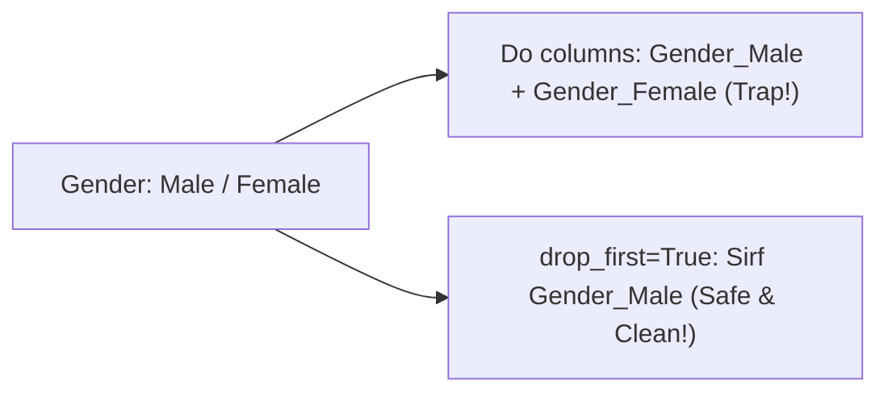

# Notes_24.02: Dummy Variable Trap Aur Multicollinearity [Hinglish]

## 📌 Topic Overview
Is lecture mein Shraddha ma'am ne **Dummy Variable Trap** ka mathematical concept samjhaya hai: kyu One-Hot Encoding karte waqt humein pehla column drop karna padta hai (`drop_first=True`), aur aisa na karne par Linear Regression ka math kyu fail ho jata hai.

---

### 📋 Is Topic Mein Hum Kya Seekhenge?
- Dummy Variable Trap kya hota hai?
- Perfect Multicollinearity ka aasan matlab.
- Matrix Singular hone ka khatra ($|X^T X| = 0$).
- `drop_first=True` lagane se problem kaise solve hoti hai.

---

### 🔍 Har Ek Point Ka Simple & Detailed Explanation

#### 1. Dummy Variable Trap Kya Hai?
Maan lijiye hamare paas `Gender` column hai jisme do values hain: `Male` aur `Female`.
Agar hum dono ke liye alag column bana dein:
- Column 1: `Gender_Male` (1 ya 0)
- Column 2: `Gender_Female` (1 ya 0)

Dhyan se dekhiye: agar kisi row mein `Gender_Male = 1` hai, toh `Gender_Female` pakka $0$ hi hoga!
Yani:

$$
\text{Gender\_Female} = 1 - \text{Gender\_Male}
$$

Dono columns ek doosre par **100% depend** karte hain. Isse Linear Regression ke normal equation matrix ka determinant zero ho jata hai aur computer divide-by-zero error mein crash ho sakta hai!

#### 2. Solution (`drop_first=True`):
Humein dono columns rakhne ki koi zaroorat nahi hai. Hum sirf `Gender_Male` rakhte hain:
- Agar `Gender_Male = 1`: Person Male hai.
- Agar `Gender_Male = 0`: Person Female hai (automatic understood!).
Isliye $k$ categories ke liye hamesha **$k - 1$ columns** hi banate hain.

---

### 📊 Visual Flowchart: Trap Ka Solution



---

### 💻 Python Code

```python
import pandas as pd

def demonstrate_dummy_variable_trap():
    """
    Demonstrates the Dummy Variable Trap and its resolution:
    If a category has K distinct values, One-Hot Encoding creates K dummy columns.
    Since sum(dummies) = 1, one dummy column is perfectly predictable from the others:
        D_k = 1 - sum_{j=1}^{k-1} D_j
    This causes Perfect Multicollinearity and breaks Matrix Inversion (X^T X)^-1.
    
    Resolution: Always use pd.get_dummies(..., drop_first=True) to retain (K-1) dummies.
    """
    df = pd.DataFrame({
        'Gender': ['Male', 'Female', 'Female', 'Male'],
        'Salary': [50000, 60000, 55000, 52000]
    })
    
    # 1. Trapped OHE (K dummies for K classes => Multicollinear!)
    trapped_ohe = pd.get_dummies(df, columns=['Gender'], drop_first=False, dtype=int)
    
    # 2. Correct OHE (K-1 dummies => Leak-free & Invertible!)
    safe_ohe = pd.get_dummies(df, columns=['Gender'], drop_first=True, dtype=int)
    
    return trapped_ohe, safe_ohe

# --- Function Call & Testing ---
trapped, safe = demonstrate_dummy_variable_trap()
print("Trapped One-Hot Encoding (Both Male and Female columns present):")
print(trapped)
print()
print("Correct One-Hot Encoding (drop_first=True => Only 1 column needed):")
print(safe)
```

---

### 📌 Summary Points
- Hamesha $k-1$ dummy columns rakhein.
- pandas mein `pd.get_dummies(..., drop_first=True)` use karein.
