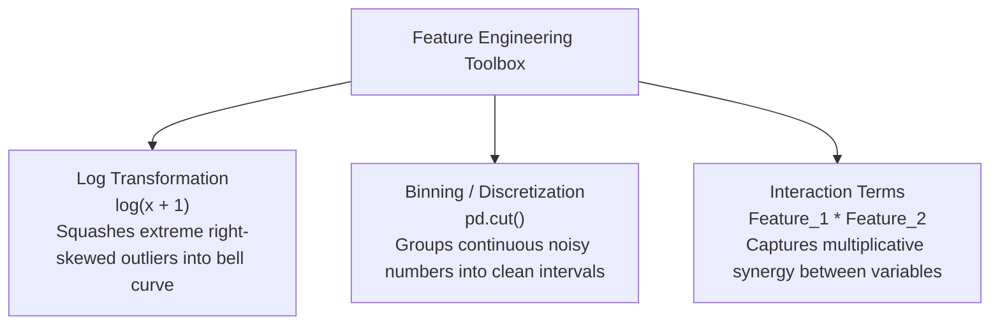

# Lecture 24.03: Other Feature Engineering Techniques

## 📌 Topic Overview
In this lecture, Shraddha ma'am covers essential **Feature Engineering Transformations** beyond encoding: **Log Transformations**, **Binning (Discretization)**, and **Interaction Terms**.

---

## 🏛️ Feature Transformation Toolbox



---

## 🛠️ Transformations Explained
1. **Log Transformation**: Financial features (Income, House Prices, Transaction Volumes) often span orders of magnitude. Applying $\log(x)$ pulls extreme outliers closer to the mean, helping linear models fit better.
2. **Binning**: Groups continuous numerical data into discrete ordinal bins (e.g., Age $\to$ Youth, Middle-Aged, Senior). Useful when relationship is non-linear across age thresholds.
3. **Interaction Terms**: Multiplies two features together ($x_1 \cdot x_2$) to allow a linear model to capture non-linear joint interactions.

---

## 💻 Python Implementation

```python
import numpy as np
import pandas as pd

def apply_advanced_feature_engineering():
    """
    Demonstrates common feature transformation techniques covered in lecture 24.03:
    1. Log Transformation: Compresses heavy right-skewed distributions
    2. Binning / Discretization: Converts continuous ages into discrete age groups
    3. Interaction Features: Multiplies features to capture joint effects
    """
    df = pd.DataFrame({
        'Income': [25000, 32000, 48000, 85000, 250000, 1200000],  # Right-skewed wealth
        'Age': [19, 28, 42, 65, 33, 58],
        'Hours_Worked': [20, 40, 45, 10, 50, 60]
    })
    
    # 1. Log Transformation: log1p(x) handles zero gracefully
    df['Income_Log'] = np.log1p(df['Income']).round(2)
    
    # 2. Binning continuous Age into groups
    bins = [0, 25, 45, 100]
    labels = ['Young', 'Middle_Aged', 'Senior']
    df['Age_Group'] = pd.cut(df['Age'], bins=bins, labels=labels)
    
    # 3. Interaction Term: Income * Hours
    df['Productivity_Index'] = (df['Income'] * df['Hours_Worked']) / 100000
    
    return df

# --- Function Call & Testing ---
fe_df = apply_advanced_feature_engineering()
print("Engineered DataFrame:")
print(fe_df[['Income', 'Income_Log', 'Age', 'Age_Group', 'Productivity_Index']])
```

---

## 🔑 Key Takeaways
1. Log transformation stabilizes variance and normalizes right-skewed variables.
2. Binning simplifies noisy signals into actionable business categories.
3. Interaction features give linear models the power to model non-linear synergies.
