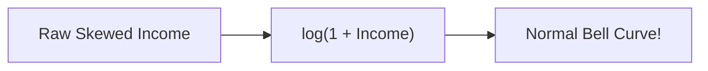

# Notes_24.03: Feature Engineering Ke Anya Tareeqe [Hinglish]

## 📌 Topic Overview
Is lecture mein Shraddha ma'am ne encoding ke alawa baaki zaroori **Feature Engineering techniques** sikhayi hain: **Log Transformation**, **Binning**, aur **Interaction Features**.

---

### 📋 Is Topic Mein Hum Kya Seekhenge?
- Log Transformation kyu karte hain (Amiri-Garibi skewness theek karna).
- Continuous data ko Bins (Groups) mein baantna (`pd.cut`).
- Interaction Terms: Do features ko aapas mein multiply karna ($x_1 \times x_2$).
- Real-world tabular data par inka asar.

---

### 🔍 Har Ek Point Ka Simple & Detailed Explanation

#### 1. Log Transformation ($\log(x)$):
Real world mein zyadatar log ₹30,000 se ₹80,000 kamate hain, lekin 1-2 log ₹50 Lakh ya ₹1 Crore kamate hain. Yeh ameer log curve ko bohot lamba kheench dete hain (Right-Skewed).
$\log(x)$ lagane se croron ke numbers chhotey ho jaate hain aur poora data ek sundar normal bell curve ban jata hai!

#### 2. Binning (Age Groups):
Age 19, 21, 23 ko alag-alag dekhne ki jagah hum unhe ek group de dete hain: `Youth` ($0-25$), `Adult` ($25-50$), aur `Senior` ($50+$).

#### 3. Interaction Terms:
Kayi baar do cheezein milkar asar karti hain: jaise `Engine_Size` $\times$ `Car_Weight`. Inhe multiply karke naya feature banane se Linear Regression non-linear patterns samajhne lagta hai.

---

### 📊 Visual Flowchart: Transformations



---

### 💻 Python Code

```python
import numpy as np
import pandas as pd

def apply_advanced_feature_engineering():
    """
    Demonstrates common feature transformation techniques covered in lecture 24.03:
    1. Log Transformation: Compresses heavy right-skewed distributions
    2. Binning / Discretization: Converts continuous ages into discrete age groups
    3. Interaction Features: Multiplies features to capture joint effects
    """
    df = pd.DataFrame({
        'Income': [25000, 32000, 48000, 85000, 250000, 1200000],  # Right-skewed wealth
        'Age': [19, 28, 42, 65, 33, 58],
        'Hours_Worked': [20, 40, 45, 10, 50, 60]
    })
    
    # 1. Log Transformation: log1p(x) handles zero gracefully
    df['Income_Log'] = np.log1p(df['Income']).round(2)
    
    # 2. Binning continuous Age into groups
    bins = [0, 25, 45, 100]
    labels = ['Young', 'Middle_Aged', 'Senior']
    df['Age_Group'] = pd.cut(df['Age'], bins=bins, labels=labels)
    
    # 3. Interaction Term: Income * Hours
    df['Productivity_Index'] = (df['Income'] * df['Hours_Worked']) / 100000
    
    return df

# --- Function Call & Testing ---
fe_df = apply_advanced_feature_engineering()
print("Engineered DataFrame:")
print(fe_df[['Income', 'Income_Log', 'Age', 'Age_Group', 'Productivity_Index']])
```

---

### 📌 Summary Points
- Log transformation outliers aur skewness ko control karta hai.
- Smart features banane se model ki accuracy badhti hai.
