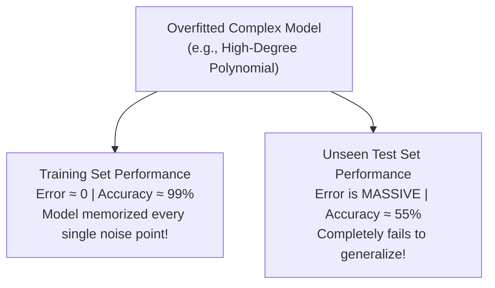

# Lecture 24.04: Overfitting (High Variance & Memorizing Noise)

## 📌 Topic Overview
In this lecture, Shraddha ma'am introduces **Overfitting**, the classic machine learning pitfall where a model fits the training data too closely, learning random noise instead of the true underlying data patterns.

---

## 🏛️ The Symptoms of Overfitting



---

## 💡 Real-World Student Analogy: The "Ratta" Student
Shraddha ma'am uses a relatable analogy:
- A student memorizes (*ratta marta hai*) every single past exam question and answer word-for-word, down to the comma.
- In class practice exams, the student scores 100/100.
- But in the final exam, when the teacher slightly changes the numbers in the question, the student fails completely!
- The student memorized the **noise**, rather than learning the underlying **concept**.

---

## 💻 Python Implementation

```python
import numpy as np

def simulate_overfitting_behavior():
    """
    Demonstrates the signature symptoms of Overfitting (High Variance):
    - Training Error: Near Zero (99%+ Accuracy)
    - Testing Error: Extremely High (60% Accuracy)
    - Root Cause: Model has too many parameters, memorizing training noise
    """
    np.random.seed(42)
    # Synthetic ground truth: y = x^2 + noise
    x_train = np.linspace(-3, 3, 10)
    y_train = x_train ** 2 + np.random.normal(0, 1.5, size=10)
    
    x_test = np.linspace(-3, 3, 10) + 0.15
    y_test = x_test ** 2 + np.random.normal(0, 1.5, size=10)
    
    # 1. Degree 9 Polynomial: 10 parameters for 10 data points!
    poly_weights = np.polyfit(x_train, y_train, deg=9)
    poly_model = np.poly1d(poly_weights)
    
    train_mse = np.mean((poly_model(x_train) - y_train) ** 2)
    test_mse  = np.mean((poly_model(x_test) - y_test) ** 2)
    
    return {
        'degree': 9,
        'train_mse': float(train_mse),
        'test_mse': float(test_mse),
        'is_overfitting': test_mse > 5 * train_mse
    }

# --- Function Call & Testing ---
sim = simulate_overfitting_behavior()
print(f"Polynomial Degree : {sim['degree']}")
print(f"Training MSE Error: {sim['train_mse']:.6f} (Almost 0 - Memorized training points!)")
print(f"Testing MSE Error : {sim['test_mse']:.2f} (Massive error on new data!)")
print(f"Overfitting Detected: {sim['is_overfitting']}")
```

---

## 🔑 Key Takeaways
1. Overfitting occurs when a model has too much capacity relative to the amount of training data.
2. Hallmarked by near-zero training error paired with massive test error (High Variance).
3. Overfitted decision boundaries appear excessively wiggly and jagged.
