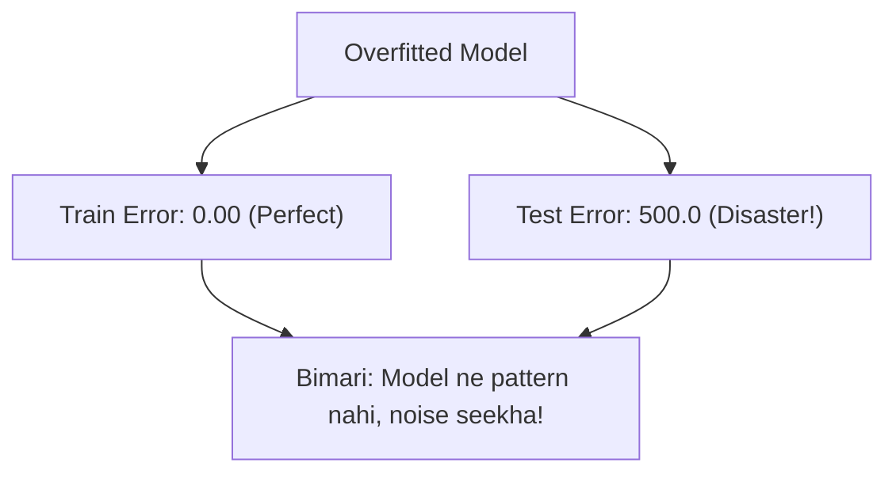

# Notes_24.04: Overfitting (High Variance Aur Ratta Marna) [Hinglish]

## 📌 Topic Overview
Is lecture mein Shraddha ma'am ne Machine Learning ki sabse badi bimari **Overfitting (High Variance)** ko samjhaya hai: kaise model training data ko ratta maar leta hai aur naye data par fail ho jata hai.

---

### 📋 Is Topic Mein Hum Kya Seekhenge?
- Overfitting kya hoti hai?
- Ratta marne wale student ki relatable analogy.
- High Variance ka matlab.
- Overfitting ke lakshan (Train error 0, Test error bohot bada).

---

### 🔍 Har Ek Point Ka Simple & Detailed Explanation

#### 1. Overfitting Ka Matlab:
Jab model data ke asli pattern ko samajhne ke bajaye data ke andar ke faltu kachre (noise) ko bhi yaad kar leta hai, toh usse **Overfitting** kehte hain.
Graph par best fit line banne ke bajaye curve har ek point ko chhoone ke chakkar mein teeda-medha (zigzag/wiggly) ban jata hai!

#### 2. Ratta Maar Student Analogy:
- Ek student ne pura question paper answer samet ratta maar liya.
- Class ke mock test mein uske 100/100 aaye (Low Train Error).
- Lekin main exam mein jab teacher ne question mein sirf ek number badal diya, toh student fail ho gaya (High Test Error)!
Is bimari ko AI mein **Overfitting** kehte hain.

---

### 📊 Visual Flowchart: Overfitting Symptoms



---

### 💻 Python Code

```python
import numpy as np

def simulate_overfitting_behavior():
    """
    Demonstrates the signature symptoms of Overfitting (High Variance):
    - Training Error: Near Zero (99%+ Accuracy)
    - Testing Error: Extremely High (60% Accuracy)
    - Root Cause: Model has too many parameters, memorizing training noise
    """
    np.random.seed(42)
    # Synthetic ground truth: y = x^2 + noise
    x_train = np.linspace(-3, 3, 10)
    y_train = x_train ** 2 + np.random.normal(0, 1.5, size=10)
    
    x_test = np.linspace(-3, 3, 10) + 0.15
    y_test = x_test ** 2 + np.random.normal(0, 1.5, size=10)
    
    # 1. Degree 9 Polynomial: 10 parameters for 10 data points!
    poly_weights = np.polyfit(x_train, y_train, deg=9)
    poly_model = np.poly1d(poly_weights)
    
    train_mse = np.mean((poly_model(x_train) - y_train) ** 2)
    test_mse  = np.mean((poly_model(x_test) - y_test) ** 2)
    
    return {
        'degree': 9,
        'train_mse': float(train_mse),
        'test_mse': float(test_mse),
        'is_overfitting': test_mse > 5 * train_mse
    }

# --- Function Call & Testing ---
sim = simulate_overfitting_behavior()
print(f"Polynomial Degree : {sim['degree']}")
print(f"Training MSE Error: {sim['train_mse']:.6f} (Almost 0 - Memorized training points!)")
print(f"Testing MSE Error : {sim['test_mse']:.2f} (Massive error on new data!)")
print(f"Overfitting Detected: {sim['is_overfitting']}")
```

---

### 📌 Summary Points
- Train mein 100% aur test mein fail = Overfitting.
- Model zyada complex hone par overfitting hoti hai.
