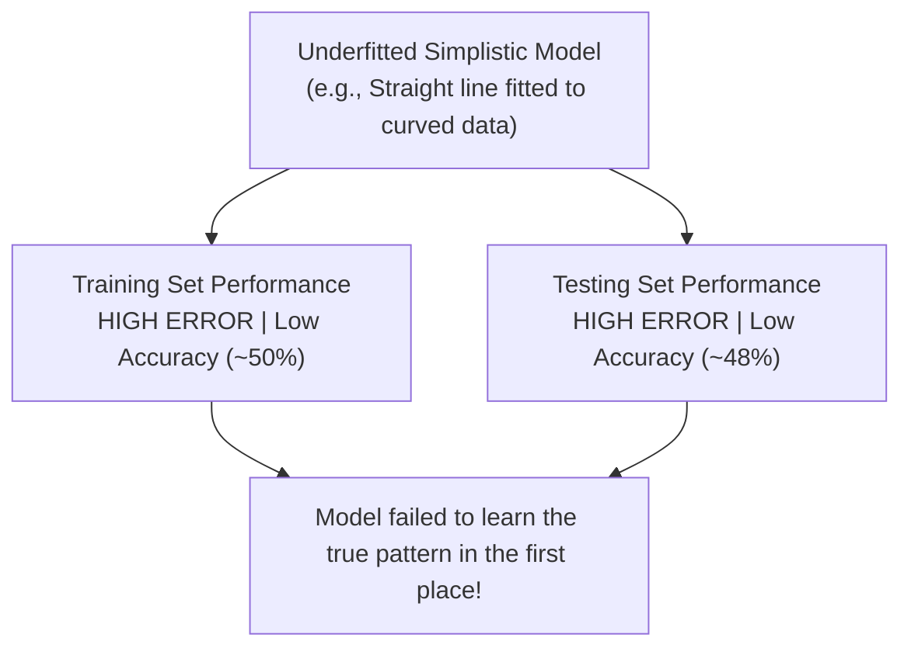

# Lecture 24.05: Underfitting (High Bias & Oversimplification)

## 📌 Topic Overview
In this lecture, Shraddha ma'am covers **Underfitting**, the opposite extreme of overfitting, where a model is too simplistic to learn the underlying structure of the data.

---

## 🏛️ The Symptoms of Underfitting



---

## 💡 The Unprepared Student Analogy
- An underfitted model is like a student who never studied the textbook at all.
- The student fails both the classroom practice test and the final exam!
- There is no gap between training error and test error — **both are terrible**.

---

## 💻 Python Implementation

```python
import numpy as np

def simulate_underfitting_behavior():
    """
    Demonstrates the signature symptoms of Underfitting (High Bias):
    - Training Error: High
    - Testing Error: High
    - Root Cause: Model is too simplistic to capture underlying non-linear curvature
    """
    np.random.seed(42)
    # True non-linear quadratic relationship: y = x^2
    x = np.linspace(-3, 3, 20)
    y = x ** 2 + np.random.normal(0, 0.5, size=20)
    
    # Underfitted Model: Fitting a straight line (Degree 1) to a parabola
    linear_weights = np.polyfit(x, y, deg=1)
    linear_model = np.poly1d(linear_weights)
    
    train_mse = np.mean((linear_model(x) - y) ** 2)
    
    return {
        'model_type': 'Linear Model on Quadratic Data (Degree 1)',
        'train_mse': float(train_mse),
        'symptom': 'High error on both training and test data'
    }

# --- Function Call & Testing ---
underfit_sim = simulate_underfitting_behavior()
print("Underfitting Simulation:")
print(f"  Model Type : {underfit_sim['model_type']}")
print(f"  Train Error: {underfit_sim['train_mse']:.4f} (High error due to oversimplification!)")
print(f"  Conclusion : {underfit_sim['symptom']}")
```

---

## 🔑 Key Takeaways
1. Underfitting occurs when the model makes strong, incorrect assumptions about the data (High Bias).
2. Characterized by high error on **both** training and test datasets.
3. Fitting a linear regression line to complex non-linear data is the classic example of underfitting.
