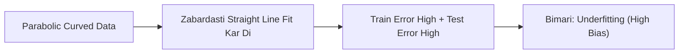

# Notes_24.05: Underfitting (High Bias Aur Oversimplification) [Hinglish]

## 📌 Topic Overview
Is lecture mein Shraddha ma'am ne **Underfitting (High Bias)** ka concept samjhaya hai: jab model itna aalsi ya seedha hota hai ki woh data ke basic pattern ko bhi nahi seekh pata.

---

### 📋 Is Topic Mein Hum Kya Seekhenge?
- Underfitting kya hoti hai?
- Padhaai na karne wale aalsi student ki analogy.
- High Bias ka matlab.
- Underfitting ke lakshan (Train aur Test dono mein kharab score).

---

### 🔍 Har Ek Point Ka Simple & Detailed Explanation

#### 1. Underfitting Ka Matlab:
Maan lijiye aapka data ek ghumaavdaar curve (Parabola) hai. Lekin aapne zabardasti uspar ek seedhi lakir (Straight line) kheench di:
Line data ke ghumaav ko pakad hi nahi sakti!
Nateeja yeh hota hai ki model **training set par bhi fail hota hai aur testing set par bhi fail hota hai**.

#### 2. Aalsi Student Analogy:
Yeh woh student hai jisne poore saal kitaab kholi hi nahi:
- Class test mein bhi fail (High Train Error).
- Final exam mein bhi fail (High Test Error).

---

### 📊 Visual Flowchart: Underfit



---

### 💻 Python Code

```python
import numpy as np

def simulate_underfitting_behavior():
    """
    Demonstrates the signature symptoms of Underfitting (High Bias):
    - Training Error: High
    - Testing Error: High
    - Root Cause: Model is too simplistic to capture underlying non-linear curvature
    """
    np.random.seed(42)
    # True non-linear quadratic relationship: y = x^2
    x = np.linspace(-3, 3, 20)
    y = x ** 2 + np.random.normal(0, 0.5, size=20)
    
    # Underfitted Model: Fitting a straight line (Degree 1) to a parabola
    linear_weights = np.polyfit(x, y, deg=1)
    linear_model = np.poly1d(linear_weights)
    
    train_mse = np.mean((linear_model(x) - y) ** 2)
    
    return {
        'model_type': 'Linear Model on Quadratic Data (Degree 1)',
        'train_mse': float(train_mse),
        'symptom': 'High error on both training and test data'
    }

# --- Function Call & Testing ---
underfit_sim = simulate_underfitting_behavior()
print("Underfitting Simulation:")
print(f"  Model Type : {underfit_sim['model_type']}")
print(f"  Train Error: {underfit_sim['train_mse']:.4f} (High error due to oversimplification!)")
print(f"  Conclusion : {underfit_sim['symptom']}")
```

---

### 📌 Summary Points
- Train aur Test dono mein kharab score = Underfitting.
- Model data ke complexity ke hisab se bohot simple hone par underfitting hoti hai.
