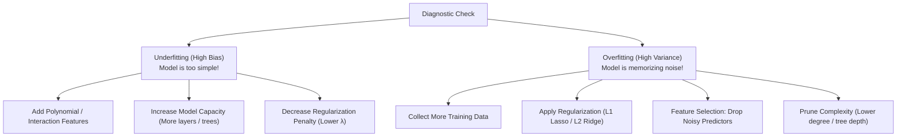

# Lecture 24.06: How to Fix Underfitting & Overfitting

## 📌 Topic Overview
In this lecture, Shraddha ma'am presents the practical **Machine Learning Playbook** for resolving Underfitting and Overfitting in real-world tabular projects.

---

## 🏛️ The Remediation Playbook



---

## 💻 Python Implementation

```python
def get_remedies_for_fit_issues():
    """
    Returns the comprehensive engineering playbook to cure
    Underfitting (High Bias) and Overfitting (High Variance).
    """
    remedies = {
        'Fixing Underfitting (High Bias)': [
            "Increase model complexity (e.g., use polynomial degree 2 or 3 instead of linear)",
            "Engineer more informative features and domain interaction terms",
            "Reduce regularization strength (decrease lambda / alpha)",
            "Train longer or optimize training convergence"
        ],
        'Fixing Overfitting (High Variance)': [
            "Collect more training data (dilutes random noise memorization)",
            "Apply Regularization: L1 Lasso (feature sparsity) or L2 Ridge (weight shrinkage)",
            "Reduce model complexity (prune trees, lower polynomial degree)",
            "Perform Feature Selection to drop noisy, irrelevant features",
            "Use K-Fold Cross Validation and early stopping"
        ]
    }
    return remedies

# --- Function Call & Testing ---
playbook = get_remedies_for_fit_issues()
for problem, solutions in playbook.items():
    print(f"=== {problem} ===")
    for sol in solutions:
        print(f" * {sol}")
    print()
```

---

## 🔑 Key Takeaways
1. To fix underfitting: make the model more expressive and feed it richer features.
2. To fix overfitting: constrain the model's freedom via regularization and data expansion.
