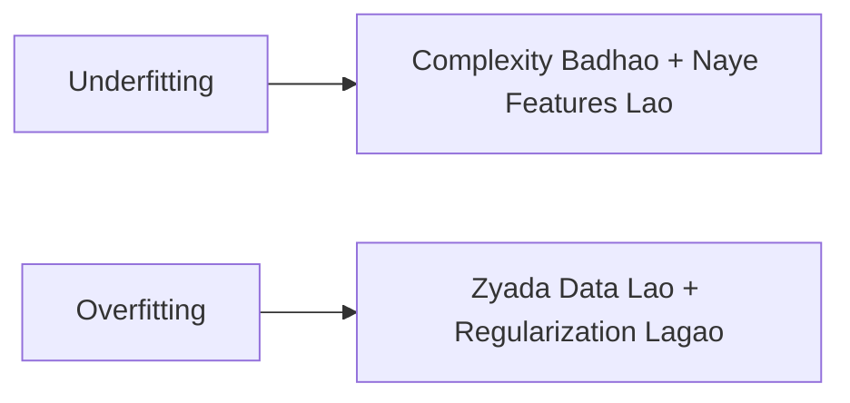

# Notes_24.06: Underfitting Aur Overfitting Ko Kaise Theek Karein [Hinglish]

## 📌 Topic Overview
Is lecture mein Shraddha ma'am ne dono bimariyon (**Underfitting** aur **Overfitting**) ko theek karne ke practical nuskhe aur industry best practices samjhaye hain.

---

### 📋 Is Topic Mein Hum Kya Seekhenge?
- Underfitting ko theek karne ke 3 tareeqe.
- Overfitting ko theek karne ke 4 tareeqe.
- Regularization (Lasso/Ridge) ka preview.
- Data badhana kyu sabse bada ilaaj hai.

---

### 🔍 Har Ek Point Ka Simple & Detailed Explanation

#### 1. Underfitting Kaise Theek Karein?
Kyunki model bohot seedha hai:
1. **Model ko complex banao**: Straight line ki jagah Polynomial ($x^2, x^3$) lagao.
2. **Naye smart features banao**: Data mein ache indicators add karo.
3. **Regularization kam karo**: Model par lagi pabandiyan hatao.

#### 2. Overfitting Kaise Theek Karein?
Kyunki model ratta maar raha hai:
1. **Aur zyada data lao**: Jab 100 rows ki jagah 10,000 rows aayengi, toh model ratta nahi maar payega, usse asli pattern seekhna hi padega!
2. **Regularization lagao (Lasso / Ridge)**: Model ke weights par penalty lagao taaki woh over-react na kare.
3. **Faltu features drop karo**: Sirf kaam ke columns rakho.

---

### 📊 Visual Flowchart: Quick Guide



---

### 💻 Python Code

```python
def get_remedies_for_fit_issues():
    """
    Returns the comprehensive engineering playbook to cure
    Underfitting (High Bias) and Overfitting (High Variance).
    """
    remedies = {
        'Fixing Underfitting (High Bias)': [
            "Increase model complexity (e.g., use polynomial degree 2 or 3 instead of linear)",
            "Engineer more informative features and domain interaction terms",
            "Reduce regularization strength (decrease lambda / alpha)",
            "Train longer or optimize training convergence"
        ],
        'Fixing Overfitting (High Variance)': [
            "Collect more training data (dilutes random noise memorization)",
            "Apply Regularization: L1 Lasso (feature sparsity) or L2 Ridge (weight shrinkage)",
            "Reduce model complexity (prune trees, lower polynomial degree)",
            "Perform Feature Selection to drop noisy, irrelevant features",
            "Use K-Fold Cross Validation and early stopping"
        ]
    }
    return remedies

# --- Function Call & Testing ---
playbook = get_remedies_for_fit_issues()
for problem, solutions in playbook.items():
    print(f"=== {problem} ===")
    for sol in solutions:
        print(f" * {sol}")
    print()
```

---

### 📌 Summary Points
- Underfitting $\to$ Model ko taakat do (Complexity badhao).
- Overfitting $\to$ Model ko lagam lagao (Regularization lagao).
