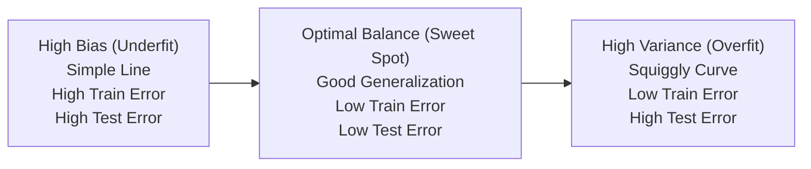

# Lecture 24.07: Diagnostic Framework — Bias vs. Variance

## 📌 Topic Overview
In this lecture, Shraddha ma'am introduces the **Bias-Variance Tradeoff**, providing an objective diagnostic decision tree to classify any trained model as Underfitted, Overfitted, or Balanced.

---

## 🏛️ The Bias-Variance Spectrum



---

## 📊 Diagnostic Decision Matrix

| Metric Pattern | Diagnosis | Underlying Mechanism |
| :--- | :--- | :--- |
| **Train Low, Test Low** | **Underfitting** | High Bias: Model too simplistic to learn patterns |
| **Train High, Test Low** | **Overfitting** | High Variance: Model memorized training noise |
| **Train High, Test High** | **Optimal Fit** | Low Bias + Low Variance: True Generalization |

---

## 💻 Python Implementation

```python
def diagnose_model_fit(train_score, test_score, threshold=0.10):
    """
    Diagnoses model health based on the Bias-Variance Tradeoff:
    - High Bias (Underfit): Both train and test scores are unacceptable (< 0.70)
    - High Variance (Overfit): Train score is high, but test score lags by > threshold
    - Good Generalization (Sweet Spot): Both scores are high and close to each other
    """
    score_gap = train_score - test_score
    
    if train_score < 0.70 and test_score < 0.70:
        diagnosis = "Underfitting (High Bias)"
        action = "Increase model complexity, add features, decrease regularization."
    elif score_gap > threshold:
        diagnosis = "Overfitting (High Variance)"
        action = "Apply L1/L2 regularization, gather more data, prune model features."
    else:
        diagnosis = "Balanced Fit (Good Generalization)"
        action = "Model is well-tuned! Ready for validation and production testing."
        
    return {
        'train_score': train_score,
        'test_score': test_score,
        'gap': score_gap,
        'diagnosis': diagnosis,
        'recommended_action': action
    }

# --- Function Call & Testing ---
print("Case 1 (Train: 0.98, Test: 0.62) =>", diagnose_model_fit(0.98, 0.62)['diagnosis'])
print("Case 2 (Train: 0.58, Test: 0.54) =>", diagnose_model_fit(0.58, 0.54)['diagnosis'])
print("Case 3 (Train: 0.88, Test: 0.86) =>", diagnose_model_fit(0.88, 0.86)['diagnosis'])
```

---

## 🔑 Key Takeaways
1. Total error consists of $\text{Bias}^2 + \text{Variance} + \text{Irreducible Noise}$.
2. As model complexity increases, bias decreases while variance increases.
3. The machine learning engineer's goal is finding the sweet spot that minimizes total error.
