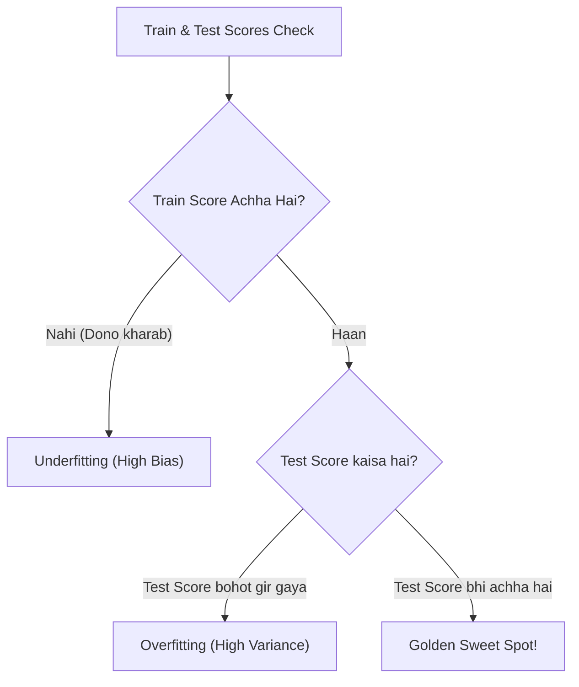

# Notes_24.07: Diagnostic Framework (Bias vs Variance) [Hinglish]

## 📌 Topic Overview
Is lecture mein Shraddha ma'am ne **Bias vs Variance Tradeoff** ka complete diagnostic framework sikhaya hai: Train aur Test scores dekhkar turant kaise pehchanein ki model kahan atak raha hai.

---

### 📋 Is Topic Mein Hum Kya Seekhenge?
- Bias kya hota hai aur Variance kya hota hai?
- The Sweet Spot (Golden Balance).
- 3 Cases: Train Score vs Test Score ka comparison.
- Error formula: $\text{Total Error} = \text{Bias}^2 + \text{Variance} + \text{Noise}$.

---

### 🔍 Har Ek Point Ka Simple & Detailed Explanation

#### 1. Bias vs Variance Ka Aasan Matlab:
- **Bias (Galat Dharna)**: Model shuru se hi maan baitha hai ki data simple hai. Isliye woh naye patterns seekhta hi nahi (Underfitting).
- **Variance (Bhatkav)**: Naya data aate hi model ka behaviour achanak badal jata hai. Woh training data ke hisab se over-sensitive ho gaya tha (Overfitting).

#### 2. Pehchanein Kaise?
1. **Case 1**: Train Score = 98%, Test Score = 60% $\implies$ **Overfitting (High Variance)**.
2. **Case 2**: Train Score = 55%, Test Score = 52% $\implies$ **Underfitting (High Bias)**.
3. **Case 3**: Train Score = 89%, Test Score = 87% $\implies$ **Perfect Generalization (Sweet Spot!)**.

---

### 📊 Visual Flowchart: Diagnostic Check



---

### 💻 Python Code

```python
def diagnose_model_fit(train_score, test_score, threshold=0.10):
    """
    Diagnoses model health based on the Bias-Variance Tradeoff:
    - High Bias (Underfit): Both train and test scores are unacceptable (< 0.70)
    - High Variance (Overfit): Train score is high, but test score lags by > threshold
    - Good Generalization (Sweet Spot): Both scores are high and close to each other
    """
    score_gap = train_score - test_score
    
    if train_score < 0.70 and test_score < 0.70:
        diagnosis = "Underfitting (High Bias)"
        action = "Increase model complexity, add features, decrease regularization."
    elif score_gap > threshold:
        diagnosis = "Overfitting (High Variance)"
        action = "Apply L1/L2 regularization, gather more data, prune model features."
    else:
        diagnosis = "Balanced Fit (Good Generalization)"
        action = "Model is well-tuned! Ready for validation and production testing."
        
    return {
        'train_score': train_score,
        'test_score': test_score,
        'gap': score_gap,
        'diagnosis': diagnosis,
        'recommended_action': action
    }

# --- Function Call & Testing ---
print("Case 1 (Train: 0.98, Test: 0.62) =>", diagnose_model_fit(0.98, 0.62)['diagnosis'])
print("Case 2 (Train: 0.58, Test: 0.54) =>", diagnose_model_fit(0.58, 0.54)['diagnosis'])
print("Case 3 (Train: 0.88, Test: 0.86) =>", diagnose_model_fit(0.88, 0.86)['diagnosis'])
```

---

### 📌 Summary Points
- Train aur Test ke beech ka bada gap = Overfitting.
- Dono ka kam score = Underfitting.
