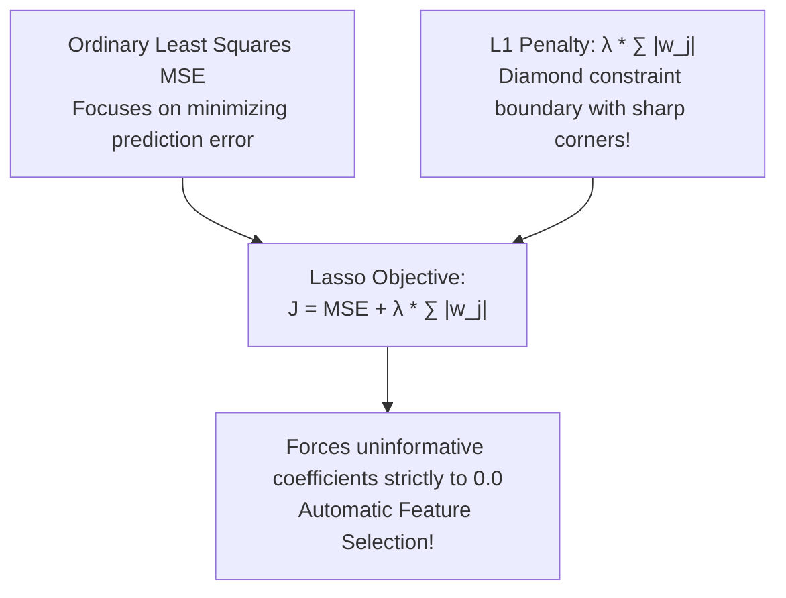

# Lecture 24.08: Regularization — Lasso Regression (L1 Norm)

## 📌 Topic Overview
In this lecture, Shraddha ma'am introduces **Lasso Regression (Least Absolute Shrinkage and Selection Operator)**, explaining how adding an **L1 Norm penalty** to the cost function cures overfitting and performs automatic feature selection.

---

## 🏛️ The Lasso Cost Function

$$
J_{\text{Lasso}}(\mathbf{w}) = \frac{1}{2m} \sum_{i=1}^m \left(\hat{y}^{(i)} - y^{(i)}\right)^2 + \lambda \sum_{j=1}^d |w_j|
$$

Where:
- $\lambda \ge 0$ (or `alpha` in Scikit-Learn) is the **regularization hyperparameter**.
- The second term is the **L1 Norm penalty**: the sum of absolute values of weights.



---

## 💡 The Diamond Constraint Geometry
Because the L1 norm creates a sharp diamond-shaped constraint region in parameter space, the elliptical MSE error contours frequently intersect the constraint region at its sharp vertices (corners). At any vertex, one or more coordinate weights equal **exactly zero**!

---

## 💻 Python Implementation

```python
import numpy as np
from sklearn.linear_model import Lasso

def demonstrate_lasso_feature_selection():
    """
    Demonstrates Lasso Regression (L1 Regularization):
    Cost = MSE + alpha * sum(|theta_j|)
    
    Property: Forces uninformative feature coefficients strictly to 0.0 (Feature Sparsity).
    """
    # Synthetic data: 5 features, but only features 0 and 1 are truly informative
    np.random.seed(42)
    X = np.random.randn(50, 5)
    # y depends only on X0 and X1; X2, X3, X4 are pure random noise
    y = 5.0 * X[:, 0] - 3.0 * X[:, 1] + np.random.normal(0, 0.5, size=50)
    
    # Train Lasso with alpha = 1.0
    lasso = Lasso(alpha=1.0, random_state=42)
    lasso.fit(X, y)
    
    coefficients = lasso.coef_.tolist()
    sparse_features = [f"X{i}" for i, c in enumerate(coefficients) if abs(c) < 1e-4]
    
    return {
        'learned_coefficients': [round(c, 3) for c in coefficients],
        'eliminated_features': sparse_features
    }

# --- Function Call & Testing ---
lasso_res = demonstrate_lasso_feature_selection()
print("Lasso Learned Coefficients (X0 to X4):", lasso_res['learned_coefficients'])
print("Features eliminated (set strictly to 0) :", lasso_res['eliminated_features'])
```

---

## 🔑 Key Takeaways
1. Lasso applies an L1 penalty on the sum of absolute weights.
2. Higher values of $\lambda$ shrink more coefficients to exactly zero.
3. Serves as both a regularizer and an automatic feature selector.
