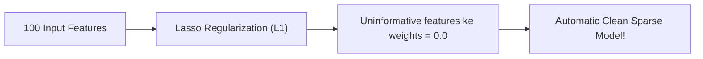

# Notes_24.08: Regularization (Lasso Regression - L1 Norm) [Hinglish]

## 📌 Topic Overview
Is lecture mein Shraddha ma'am ne **Lasso Regression (L1 Regularization)** ka concept samjhaya hai: kaise Cost function mein absolute values ($\sum |w|$) add karne se model ki overfitting theek hoti hai aur faltu features automatic delete ho jaate hain.

---

### 📋 Is Topic Mein Hum Kya Seekhenge?
- Regularization kya hoti hai aur iski zaroorat kyu hai?
- Lasso Regression ka formula: $\text{MSE} + \lambda \sum |w_j|$.
- $\lambda$ (Lambda ya Alpha) parameter ka role.
- Feature Selection: Faltu weights bilkul $0.0$ kyu ban jaate hain?

---

### 🔍 Har Ek Point Ka Simple & Detailed Explanation

#### 1. Regularization Kya Hai?
Jab model overfitting karne lagta hai (weights bohot bade-bade ho jaate hain), toh hum model ko lagam lagane ke liye ek **Fine (Penalty)** add kar dete hain:

$$
J_{\text{Lasso}}(\mathbf{w}) = \text{MSE} + \lambda \sum_{j=1}^d |w_j|
$$

Yahan model sirf error kam karne ki koshish nahi karega, balki weights ko bhi chhota rakhne ki koshish karega!

#### 2. Lasso Ka Superpower (Feature Selection):
Lasso ki geometry aisi hoti hai ki yeh un features ke coefficients ko **seedha zero ($0.0$) bana deta hai** jo target ke liye zaroori nahi hain!
Yani agar aapke data mein 100 features hain aur sirf 5 kaam ke hain, toh Lasso baaki 95 features ko drop kar dega.

---

### 📊 Visual Flowchart: Lasso Sparsity



---

### 💻 Python Code

```python
import numpy as np
from sklearn.linear_model import Lasso

def demonstrate_lasso_feature_selection():
    """
    Demonstrates Lasso Regression (L1 Regularization):
    Cost = MSE + alpha * sum(|theta_j|)
    
    Property: Forces uninformative feature coefficients strictly to 0.0 (Feature Sparsity).
    """
    # Synthetic data: 5 features, but only features 0 and 1 are truly informative
    np.random.seed(42)
    X = np.random.randn(50, 5)
    # y depends only on X0 and X1; X2, X3, X4 are pure random noise
    y = 5.0 * X[:, 0] - 3.0 * X[:, 1] + np.random.normal(0, 0.5, size=50)
    
    # Train Lasso with alpha = 1.0
    lasso = Lasso(alpha=1.0, random_state=42)
    lasso.fit(X, y)
    
    coefficients = lasso.coef_.tolist()
    sparse_features = [f"X{i}" for i, c in enumerate(coefficients) if abs(c) < 1e-4]
    
    return {
        'learned_coefficients': [round(c, 3) for c in coefficients],
        'eliminated_features': sparse_features
    }

# --- Function Call & Testing ---
lasso_res = demonstrate_lasso_feature_selection()
print("Lasso Learned Coefficients (X0 to X4):", lasso_res['learned_coefficients'])
print("Features eliminated (set strictly to 0) :", lasso_res['eliminated_features'])
```

---

### 📌 Summary Points
- Lasso L1 penalty ($\sum |w|$) use karta hai.
- Yeh faltu features ke weights ko exactly $0$ kar deta hai.
