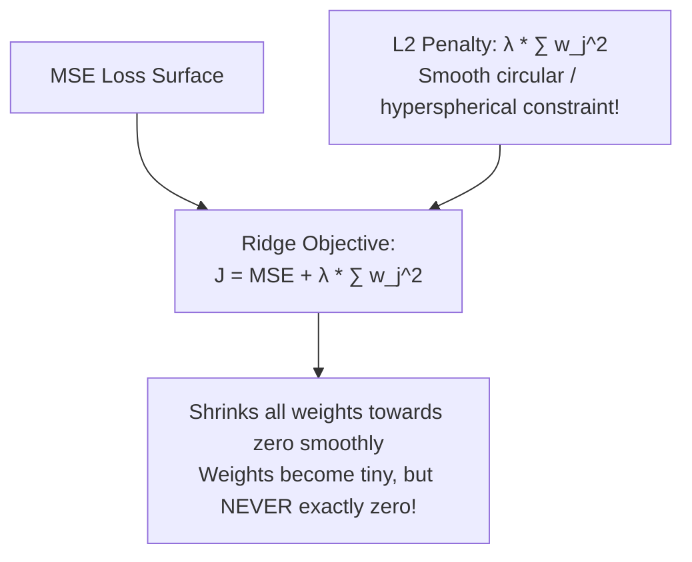

# Lecture 24.09: Regularization — Ridge Regression (L2 Norm)

## 📌 Topic Overview
In this lecture, Shraddha ma'am explores **Ridge Regression (Tikhonov Regularization)**, which applies an **L2 Norm penalty** ($\sum w_j^2$) to stabilize collinear parameters and prevent extreme weights.

---

## 🏛️ The Ridge Cost Function

$$
J_{\text{Ridge}}(\mathbf{w}) = \frac{1}{2m} \sum_{i=1}^m \left(\hat{y}^{(i)} - y^{(i)}\right)^2 + \lambda \sum_{j=1}^d w_j^2
$$

Where:
- $\sum w_j^2$ is the **L2 Norm penalty** (sum of squared weights).
- $\lambda \ge 0$ controls shrinkage intensity.



---

## ⚖️ Lasso vs Ridge Comparison

| Dimension | Lasso Regression (L1) | Ridge Regression (L2) |
| :--- | :--- | :--- |
| **Penalty Term** | $\lambda \sum |w_j|$ | $\lambda \sum w_j^2$ |
| **Constraint Shape** | Sharp Diamond (corners at axes) | Smooth Circle / Hypersphere |
| **Weight Sparsity** | Yes (weights become exactly $0.0$) | No (weights shrink close to $0$, never $0$) |
| **Feature Selection** | Built-in automatic feature selector | Retains all features with reduced weights |
| **Multicollinearity** | Picks one correlated feature arbitrarily | Distributes weights evenly across correlated features |

---

## 💻 Python Implementation

```python
import numpy as np
from sklearn.linear_model import Ridge

def demonstrate_ridge_weight_shrinkage():
    """
    Demonstrates Ridge Regression (L2 Regularization):
    Cost = MSE + alpha * sum(theta_j^2)
    
    Property: Shrinks coefficients asymptotically towards 0, but never sets them exactly to 0.
    Handles highly correlated multicollinear features robustly.
    """
    np.random.seed(42)
    X = np.random.randn(50, 5)
    y = 5.0 * X[:, 0] - 3.0 * X[:, 1] + np.random.normal(0, 0.5, size=50)
    
    # Train Ridge with alpha = 10.0
    ridge = Ridge(alpha=10.0, random_state=42)
    ridge.fit(X, y)
    
    coefficients = ridge.coef_.tolist()
    
    return {
        'learned_coefficients': [round(c, 3) for c in coefficients],
        'are_any_zero': any(abs(c) < 1e-6 for c in coefficients)
    }

# --- Function Call & Testing ---
ridge_res = demonstrate_ridge_weight_shrinkage()
print("Ridge Learned Coefficients (X0 to X4):", ridge_res['learned_coefficients'])
print("Are any coefficients exactly zero?    :", ridge_res['are_any_zero'])
```

---

## 🔑 Key Takeaways
1. Ridge regression uses an L2 squared weight penalty.
2. Shrinks weights smoothly to prevent extreme sensitivity to individual features.
3. Ideal when almost all features contribute somewhat to the target.
