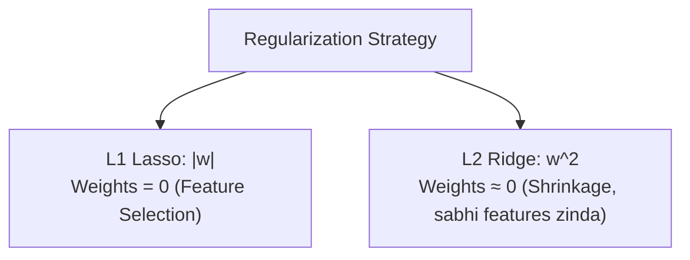

# Notes_24.09: Regularization (Ridge Regression - L2 Norm) [Hinglish]

## 📌 Topic Overview
Is lecture mein Shraddha ma'am ne **Ridge Regression (L2 Regularization)** ka concept samjhaya hai: kaise squared weights ($\sum w^2$) ki penalty lagakar model ke weights ko chhota banaya jata hai aur Lasso vs Ridge ka farq kya hai.

---

### 📋 Is Topic Mein Hum Kya Seekhenge?
- Ridge Regression ka formula: $\text{MSE} + \lambda \sum w_j^2$.
- L2 penalty ka circular shape.
- Ridge weights ko 0 kyu nahi banata?
- Lasso vs Ridge ka complete comparison table.

---

### 🔍 Har Ek Point Ka Simple & Detailed Explanation

#### 1. Ridge Regression Ka Formula:

$$
J_{\text{Ridge}}(\mathbf{w}) = \text{MSE} + \lambda \sum_{j=1}^d w_j^2
$$

Yahan penalty mein weights ka square hota hai.
Agar koi weight bohot bada ho gaya (jaise $w = 50$), toh uska square $2500$ ban kar loss ko bohot bada bana dega! Isliye model darr ke maare saare weights ko chhota-chhota ($0.1, 0.2$) rakhta hai.

#### 2. Lasso vs Ridge Ka Antar:
- **Lasso (L1)**: Weights ko **seedha zero** kar deta hai (Delete kar deta hai).
- **Ridge (L2)**: Weights ko **chhota karta hai**, lekin kabhi zero nahi karta! Saare features zinda rehte hain, bas unka asar halka ho jata hai.

---

### 📊 Visual Flowchart: Lasso vs Ridge



---

### 💻 Python Code

```python
import numpy as np
from sklearn.linear_model import Ridge

def demonstrate_ridge_weight_shrinkage():
    """
    Demonstrates Ridge Regression (L2 Regularization):
    Cost = MSE + alpha * sum(theta_j^2)
    
    Property: Shrinks coefficients asymptotically towards 0, but never sets them exactly to 0.
    Handles highly correlated multicollinear features robustly.
    """
    np.random.seed(42)
    X = np.random.randn(50, 5)
    y = 5.0 * X[:, 0] - 3.0 * X[:, 1] + np.random.normal(0, 0.5, size=50)
    
    # Train Ridge with alpha = 10.0
    ridge = Ridge(alpha=10.0, random_state=42)
    ridge.fit(X, y)
    
    coefficients = ridge.coef_.tolist()
    
    return {
        'learned_coefficients': [round(c, 3) for c in coefficients],
        'are_any_zero': any(abs(c) < 1e-6 for c in coefficients)
    }

# --- Function Call & Testing ---
ridge_res = demonstrate_ridge_weight_shrinkage()
print("Ridge Learned Coefficients (X0 to X4):", ridge_res['learned_coefficients'])
print("Are any coefficients exactly zero?    :", ridge_res['are_any_zero'])
```

---

### 📌 Summary Points
- Ridge L2 squared penalty use karta hai.
- Yeh weights ko shrink karta hai par zero nahi karta.
