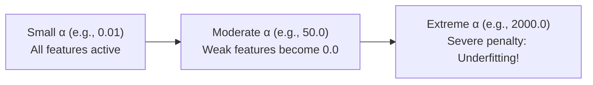

# Lecture 24.10: Lasso Regression Implementation & Shrinkage Paths

## 📌 Topic Overview
In this lecture, Shraddha ma'am demonstrates the Scikit-Learn implementation of **Lasso Regression**, iterating through candidate $\alpha$ regularization strengths to visualize the **coefficient shrinkage path**.

---

## 🛠️ The Shrinkage Trajectory
As $\alpha$ increases from $0.001$ to $1000+$:
1. At small $\alpha$, all coefficients resemble standard OLS values.
2. As $\alpha$ grows, weak features like `children` and `bmi` are driven to exactly $0.0$.
3. At very high $\alpha$, even strong features like `age` collapse, leaving only the dominant feature (`smoker`) or complete underfitting.



---

## 💻 Python Implementation

```python
import numpy as np
import pandas as pd
from sklearn.linear_model import Lasso
from sklearn.model_selection import train_test_split

def trace_lasso_shrinkage_path():
    """
    Simulates Lasso training across multiple alpha hyperparameter values
    as demonstrated by Shraddha ma'am on the classroom Insurance dataset.
    Demonstrates how increasing alpha progressively eliminates features.
    """
    np.random.seed(42)
    n = 200
    # Features: age, bmi, children, smoker
    X = pd.DataFrame({
        'age': np.random.uniform(18, 65, size=n),
        'bmi': np.random.uniform(18, 40, size=n),
        'children': np.random.randint(0, 5, size=n),
        'smoker': np.random.choice([0, 1], p=[0.8, 0.2], size=n)
    })
    y = 250 * X['age'] + 330 * X['bmi'] + 500 * X['children'] + 24000 * X['smoker'] + np.random.normal(0, 1000, size=n)
    
    alphas = [0.1, 1.0, 50.0, 500.0, 2000.0]
    path_records = []
    
    for a in alphas:
        clf = Lasso(alpha=a, random_state=42)
        clf.fit(X, y)
        coefs = {col: round(c, 2) for col, c in zip(X.columns, clf.coef_)}
        zero_count = sum(1 for c in clf.coef_ if abs(c) < 1e-3)
        path_records.append({
            'alpha': a,
            'coefficients': coefs,
            'zero_features_count': zero_count
        })
        
    return path_records

# --- Function Call & Testing ---
records = trace_lasso_shrinkage_path()
print(f"{'Alpha':<10} | {'Zero Coefs':<12} | {'Age Coef':<12} | {'BMI Coef':<12} | {'Children':<12} | {'Smoker Coef':<12}")
print("-" * 75)
for r in records:
    c = r['coefficients']
    print(f"{r['alpha']:<10.1f} | {r['zero_features_count']:<12} | {c['age']:<12.1f} | {c['bmi']:<12.1f} | {c['children']:<12.1f} | {c['smoker']:<12.1f}")
```

---

## 🔑 Key Takeaways
1. Tracing coefficient shrinkage paths shows the exact order in which features are discarded.
2. Tuning $\alpha$ is essential: too low causes overfitting; too high causes underfitting.
