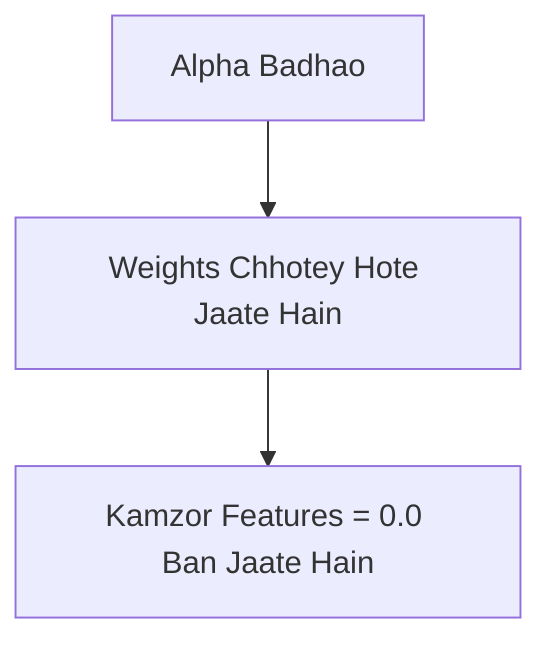

# Notes_24.10: Lasso Implementation Aur Shrinkage Path [Hinglish]

## 📌 Topic Overview
Is lecture mein Shraddha ma'am ne Scikit-Learn ke `Lasso` class ko use karke multiple $\alpha$ (Alpha) values par model train kiya hai aur dikhaya hai ki kaise Alpha badhne par features ek-ek karke zero bante jaate hain.

---

### 📋 Is Topic Mein Hum Kya Seekhenge?
- Scikit-Learn mein `Lasso(alpha=...)` lagana.
- Alpha badhane par weights ka shrinkage path.
- Weak features (jaise `children`) sabse pehle zero kyu bante hain?
- Sahi Alpha value choose karne ki zaroorat.

---

### 🔍 Har Ek Point Ka Simple & Detailed Explanation

#### 1. Alpha Ka Khel:
- **$\alpha = 0.1$ (Chhota Alpha)**: Penalty bohot kam hai, lagbhag OLS Linear Regression jaisa kaam karega. Saare features active rahenge.
- **$\alpha = 50.0$ (Balanced Alpha)**: Kamzor features zero ban jaayenge, model overfit nahi karega.
- **$\alpha = 2000.0$ (Bohot Bada Alpha)**: Penalty itni zyada ho jayegi ki model sabhi features ko zero kar dega aur **Underfitting** ho jayegi!

---

### 📊 Visual Flowchart: Alpha Ka Asar



---

### 💻 Python Code

```python
import numpy as np
import pandas as pd
from sklearn.linear_model import Lasso
from sklearn.model_selection import train_test_split

def trace_lasso_shrinkage_path():
    """
    Simulates Lasso training across multiple alpha hyperparameter values
    as demonstrated by Shraddha ma'am on the classroom Insurance dataset.
    Demonstrates how increasing alpha progressively eliminates features.
    """
    np.random.seed(42)
    n = 200
    # Features: age, bmi, children, smoker
    X = pd.DataFrame({
        'age': np.random.uniform(18, 65, size=n),
        'bmi': np.random.uniform(18, 40, size=n),
        'children': np.random.randint(0, 5, size=n),
        'smoker': np.random.choice([0, 1], p=[0.8, 0.2], size=n)
    })
    y = 250 * X['age'] + 330 * X['bmi'] + 500 * X['children'] + 24000 * X['smoker'] + np.random.normal(0, 1000, size=n)
    
    alphas = [0.1, 1.0, 50.0, 500.0, 2000.0]
    path_records = []
    
    for a in alphas:
        clf = Lasso(alpha=a, random_state=42)
        clf.fit(X, y)
        coefs = {col: round(c, 2) for col, c in zip(X.columns, clf.coef_)}
        zero_count = sum(1 for c in clf.coef_ if abs(c) < 1e-3)
        path_records.append({
            'alpha': a,
            'coefficients': coefs,
            'zero_features_count': zero_count
        })
        
    return path_records

# --- Function Call & Testing ---
records = trace_lasso_shrinkage_path()
print(f"{'Alpha':<10} | {'Zero Coefs':<12} | {'Age Coef':<12} | {'BMI Coef':<12} | {'Children':<12} | {'Smoker Coef':<12}")
print("-" * 75)
for r in records:
    c = r['coefficients']
    print(f"{r['alpha']:<10.1f} | {r['zero_features_count']:<12} | {c['age']:<12.1f} | {c['bmi']:<12.1f} | {c['children']:<12.1f} | {c['smoker']:<12.1f}")
```

---

### 📌 Summary Points
- Alpha model ki penalty ki taakat control karta hai.
- Jyada alpha = zyada features zero.
