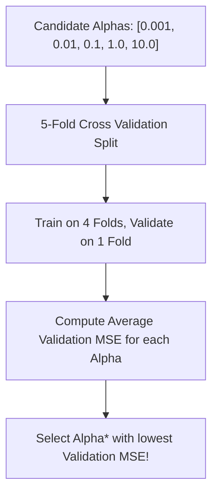

# Lecture 24.11: Using LassoCV for Automated Hyperparameter Tuning

## 📌 Topic Overview
In this lecture, Shraddha ma'am introduces **`LassoCV`**, Scikit-Learn's built-in cross-validation estimator that automatically searches for the optimal regularization strength $\alpha^*$ across a candidate grid.

---

## 🏛️ How LassoCV Works



---

## 💡 Why Use `LassoCV` Instead of Manual Loops?
1. **Automated Search**: Eliminates manual `for`-loops across alphas.
2. **Leak-Free Cross Validation**: Fits and tests on distinct rotated folds.
3. **Internal Best Model**: Automatically refits the winning $\alpha^*$ on the full training set.

---

## 💻 Python Implementation

```python
import numpy as np
from sklearn.linear_model import LassoCV

def tune_lasso_with_cross_validation():
    """
    Demonstrates LassoCV: Automated hyperparameter tuning using K-Fold Cross Validation
    to find the optimal alpha* that minimizes validation MSE.
    """
    np.random.seed(42)
    X = np.random.randn(100, 6)
    # Features 0 and 1 are signals, others are noise
    y = 4.0 * X[:, 0] - 2.5 * X[:, 1] + np.random.normal(0, 0.5, size=100)
    
    alphas_to_test = [0.001, 0.01, 0.1, 0.5, 1.0, 5.0, 10.0]
    
    # 5-fold cross-validation
    lasso_cv = LassoCV(alphas=alphas_to_test, cv=5, random_state=42, max_iter=2000)
    lasso_cv.fit(X, y)
    
    return {
        'optimal_alpha': float(lasso_cv.alpha_),
        'active_features_count': int(np.sum(np.abs(lasso_cv.coef_) > 1e-4)),
        'all_coefficients': [round(c, 3) for c in lasso_cv.coef_]
    }

# --- Function Call & Testing ---
cv_res = tune_lasso_with_cross_validation()
print(f"Optimal Alpha Selected by 5-Fold CV: {cv_res['optimal_alpha']}")
print(f"Number of Retained Features        : {cv_res['active_features_count']} of 6")
print(f"Final Model Coefficients           : {cv_res['all_coefficients']}")
```

---

## 🔑 Key Takeaways
1. Never guess the regularization parameter $\alpha$; let cross-validation find it.
2. `lasso_cv.alpha_` stores the optimal hyperparameter.
