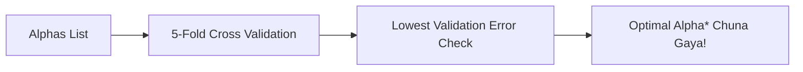

# Notes_24.11: LassoCV Se Automatic Hyperparameter Tuning [Hinglish]

## 📌 Topic Overview
Is lecture mein Shraddha ma'am ne **`LassoCV`** ka use sikhaya hai: kaise Scikit-Learn bina kisi manual loop ke khud 5-Fold Cross Validation karke **sabse best Alpha ($\alpha^*$)** dhoond nikalta hai.

---

### 📋 Is Topic Mein Hum Kya Seekhenge?
- Manual loop vs `LassoCV` ka farq.
- 5-Fold Cross Validation internal mechanism.
- `lasso_cv.alpha_` se winning alpha nikalna.
- Best model selection criteria.

---

### 🔍 Har Ek Point Ka Simple & Detailed Explanation

#### 1. LassoCV Kyu Use Karein?
Hum andaze se nahi bata sakte ki $\alpha = 0.1$ achha hai ya $\alpha = 1.0$.
`LassoCV` data ko 5 hisso (folds) mein baant ta hai:
- 4 hisso par train karta hai aur 5ve par test karta hai.
- Yeh process har candidate alpha ke liye ghumata hai.
- **Jis Alpha par validation error sabse kam aata hai**, usse winner declare kar deta hai!

---

### 📊 Visual Flowchart: LassoCV Workflow



---

### 💻 Python Code

```python
import numpy as np
from sklearn.linear_model import LassoCV

def tune_lasso_with_cross_validation():
    """
    Demonstrates LassoCV: Automated hyperparameter tuning using K-Fold Cross Validation
    to find the optimal alpha* that minimizes validation MSE.
    """
    np.random.seed(42)
    X = np.random.randn(100, 6)
    # Features 0 and 1 are signals, others are noise
    y = 4.0 * X[:, 0] - 2.5 * X[:, 1] + np.random.normal(0, 0.5, size=100)
    
    alphas_to_test = [0.001, 0.01, 0.1, 0.5, 1.0, 5.0, 10.0]
    
    # 5-fold cross-validation
    lasso_cv = LassoCV(alphas=alphas_to_test, cv=5, random_state=42, max_iter=2000)
    lasso_cv.fit(X, y)
    
    return {
        'optimal_alpha': float(lasso_cv.alpha_),
        'active_features_count': int(np.sum(np.abs(lasso_cv.coef_) > 1e-4)),
        'all_coefficients': [round(c, 3) for c in lasso_cv.coef_]
    }

# --- Function Call & Testing ---
cv_res = tune_lasso_with_cross_validation()
print(f"Optimal Alpha Selected by 5-Fold CV: {cv_res['optimal_alpha']}")
print(f"Number of Retained Features        : {cv_res['active_features_count']} of 6")
print(f"Final Model Coefficients           : {cv_res['all_coefficients']}")
```

---

### 📌 Summary Points
- Hyperparameters hamesha Cross-Validation se tune karein.
- `LassoCV` code ko clean aur automated banata hai.
