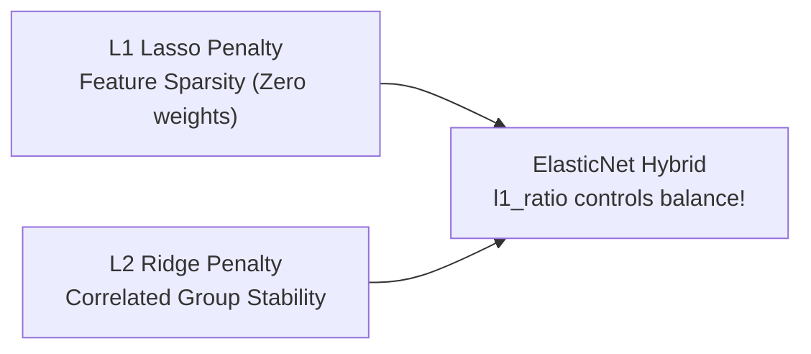

# Lecture 24.12: ElasticNet Overview (Hybrid L1 + L2 Regularization)

## 📌 Topic Overview
In this lecture, Shraddha ma'am covers **ElasticNet**, a hybrid regularization technique that linearly combines both the L1 (Lasso) and L2 (Ridge) penalties to overcome individual limitations.

---

## 🏛️ The ElasticNet Objective

$$
J_{\text{ElasticNet}}(\mathbf{w}) = \text{MSE} + \alpha \left[ \rho \sum_{j=1}^d |w_j| + \frac{1 - \rho}{2} \sum_{j=1}^d w_j^2 \right]
$$

Where:
- $\alpha \ge 0$ is the overall regularization strength.
- $\rho \in [0, 1]$ (called `l1_ratio` in Scikit-Learn) controls the balance:
  - $\rho = 1 \implies$ Pure Lasso (L1).
  - $\rho = 0 \implies$ Pure Ridge (L2).
  - $0 < \rho < 1 \implies$ Hybrid ElasticNet!



---

## 💡 Why ElasticNet?
When multiple features are highly correlated:
- Lasso tends to pick one arbitrarily and zero out the others.
- ElasticNet groups them and shrinks them together, preserving stability.

---

## 💻 Python Implementation

```python
from sklearn.linear_model import ElasticNet
import numpy as np

def demonstrate_elastic_net(l1_ratio=0.5):
    """
    Demonstrates ElasticNet (Hybrid L1 + L2 Regularization):
    Cost = MSE + alpha * [ l1_ratio * L1 + 0.5*(1 - l1_ratio) * L2 ]
    
    Combines Lasso's feature selection with Ridge's grouped selection stability.
    """
    np.random.seed(42)
    X = np.random.randn(80, 5)
    y = 3.0 * X[:, 0] + 2.0 * X[:, 1] + np.random.normal(0, 0.5, size=80)
    
    en = ElasticNet(alpha=0.5, l1_ratio=l1_ratio, random_state=42)
    en.fit(X, y)
    
    return {
        'l1_ratio': l1_ratio,
        'coefficients': [round(c, 3) for c in en.coef_]
    }

# --- Function Call & Testing ---
for ratio in [0.1, 0.5, 0.9]:
    res = demonstrate_elastic_net(l1_ratio=ratio)
    print(f"ElasticNet (l1_ratio={ratio:.1f}) Coefficients: {res['coefficients']}")
```

---

## 🔑 Key Takeaways
1. ElasticNet provides a continuous bridge between Lasso and Ridge.
2. Controlled via `l1_ratio`.
3. Standard choice when dealing with high-dimensional datasets with correlated predictor groups.
